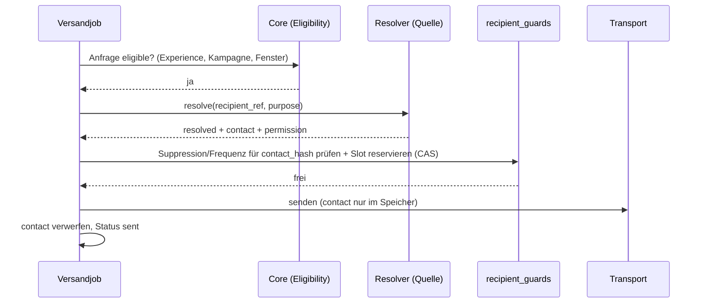

# Kontaktresolver-Vertrag v1 (RC-023)

| | |
|---|---|
| Status | Spezifikation, Entwurf zur Abnahme |
| Vertragsversion | `1.0` |
| Interface | `ReviewCaptain\Contracts\Connector\RecipientResolverInterface` (Core, lizenzfrei) |
| Registrierung | über `review_captain_connectors_v1` (Connector deklariert Fähigkeit `recipient_resolver`) |
| Bezug | TODO RC-023, RC-088, RC-090, CON-003, CON-005; konzept.md 7.4, 7.9 „Kontaktresolver“ |

## Grundsatz

Das Quell-Plugin bleibt für Kontaktangaben zuständig. Review Captain kennt bis zur Versandzeit nur die opake `recipient_ref`. Der Resolver wird **ausschließlich** vom Versandjob aufgerufen, **nach** bestandener Eligibility-Prüfung und **unmittelbar vor** der Übergabe an den Transport. Unbekannt, nicht erlaubt, widerrufen oder nicht erreichbar ⇒ **kein Versand**.

## Interface

```php
namespace ReviewCaptain\Contracts\Connector;

interface RecipientResolverInterface {
    /** Quellschlüssel, deren recipient_ref dieser Resolver auflöst, z. B. ['pass-captain']. */
    public function resolver_sources(): array;

    /** Löst genau eine Referenz auf. Darf keine Seiteneffekte in der Quelle auslösen. */
    public function resolve( array $request ): array;
}
```

Zuordnung: Der Core wählt den Resolver anhand des Präfixes von `recipient_ref` (`{source}:…`). Pro Quelle ist genau ein Resolver aktiv; ein zweiter Registrierungsversuch wird mit `rc.contract.duplicate_key` abgewiesen.

### Request

```json
{
  "contract": "1.0",
  "purpose": "review_request",
  "channel": "email",
  "recipient_ref": "pass-captain:attendee:9f8e7d6c",
  "experience_id": "pass-captain:1:attendance:T-7781:OCC-55",
  "request_uuid": "7a8b9c0d-1e2f-4a3b-8c4d-5e6f7a8b9c0d",
  "campaign_id": 12,
  "requested_at": "2026-11-17T09:00:03Z"
}
```

`purpose` v1: nur `review_request` (inkl. Erinnerung). Resolver müssen andere Zwecke ablehnen (`not_permitted`).

### Response

```json
{
  "status": "resolved",
  "contact": { "email": "gast@example.test", "display_name": "Gast", "locale": "de-AT" },
  "permission": { "status": "granted", "basis": "consent", "recorded_at": "2026-10-01T12:00:00Z", "evidence_ref": "consent-4471" }
}
```

| `status` | Bedeutung | Ergebnis der Anfrage | Code |
|---|---|---|---|
| `resolved` | Kontakt vorhanden **und** `permission.status = granted` | Versand darf erfolgen | – |
| `unknown` | Referenz unbekannt/gelöscht | `skipped` | `rc.recipient.unknown` |
| `not_permitted` | keine Versandberechtigung (`denied`/`unknown`) | `skipped` | `rc.consent.missing` |
| `revoked` | Berechtigung widerrufen / Opt-out in der Quelle | `skipped` + Suppression für `contact_hash` falls Kontakt geliefert | `rc.consent.revoked` |
| `unavailable` | Quelle vorübergehend nicht nutzbar (Plugin deaktiviert, Wartung) | Job pausiert, Anfrage bleibt `eligible` | `rc.source.unavailable` |

Weitere Regeln:

- `status = resolved` mit `permission.status ≠ granted` wird vom Core wie `not_permitted` behandelt.
- `contact.email` wird mit `is_email()` geprüft; ungültig ⇒ `skipped` / `rc.recipient.invalid_contact`.
- Exceptions/PHP-Fehler im Resolver ⇒ `rc.resolver.error` (Retry-Klasse `transient`, max. 3 Versuche, danach `failed`).
- Laufzeitbudget: 2 s je Aufruf (Messung; Überschreitung wird protokolliert, nicht abgebrochen, da lokaler PHP-Code).

## Datenumgang

| Regel | Umsetzung |
|---|---|
| Kontakt nur im Speicher | `contact` wird nicht in DB, Jobs-Payload, Logs, Transients oder Objekt-Cache geschrieben; nach Transport-Übergabe verworfen |
| Pseudonymer Abgleich | Core speichert nur `contact_hash = HMAC-SHA256(lowercase(trim(email)), hash_key)` für Suppression und Frequenzgrenze (invitation-rule.md). Schlüsselquelle: TEC-008 (offen) |
| Kein Caching | jede Versand-/Erinnerungsentscheidung ruft den Resolver erneut auf |
| Minimalumfang | nur `email`, optional `display_name` (Anrede) und `locale`; weitere Felder werden verworfen |
| Kein Aufruf außerhalb des Versandjobs | Vorschau/Testmodus verwenden den konfigurierten Testempfänger, nie den Resolver (RC-093) |
| Audit | Ergebnis-`status`, Quelle, `request_uuid`, Zeit – ohne Kontakt |

## Suite-Resolver (Anforderungen an Quell-Plugins, Bestätigung offen)

| Quelle | Resolver gehört zu | Auflösung | Berechtigungsquelle |
|---|---|---|---|
| WooCommerce | Review-Captain-Pro-Woo-Adapter | `woocommerce:customer:{id}` → Kundenkonto-E-Mail; `woocommerce:order_billing:{order_id}` → Rechnungs-E-Mail über Woo-API | konfigurierte Opt-in-Quelle (Checkout-Feld/Meta); ohne Konfiguration `not_permitted` |
| Voucher Captain | Voucher-Captain-Vertrag | Beschenkter/Käufer | Voucher Captain |
| Pass Captain | Pass-Captain-Vertrag | Teilnehmer/Käufer | Pass Captain |
| Custom Connector | Connector | eigene Referenzen | Connector |

## Ablauf



## Abnahme

- [ ] Kontaktangaben werden nur im Versandjob, nach Eligibility-Prüfung und mit gültiger Berechtigung aufgelöst (Test: Resolver-Spy wird bei Planung, Vorschau und Testmodus nicht aufgerufen).
- [ ] `unknown`, `not_permitted`, `revoked` blockieren den Versand; `unavailable` pausiert ohne Versand.
- [ ] Kontakt erscheint nach dem Versand in keiner Tabelle, keinem Log, keinem Job-Payload (DB-/Log-Scan im Integrationstest).
- [ ] Opt-out in der Quelle zwischen Planung und Versand verhindert den Versand.
- [ ] Ein zweiter Resolver für dieselbe Quelle wird abgewiesen.
