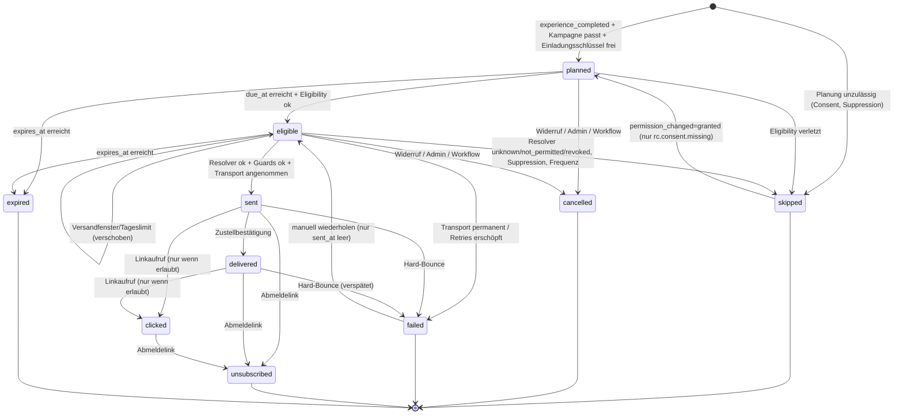

# Anfrage-Lifecycle (RC-024)

| | |
|---|---|
| Status | Spezifikation, Entwurf zur Abnahme |
| Gilt für | Review Captain Pro (`review.review_requests`) |
| Tabelle | `{prefix}review_captain_requests` (Pro, Vorschlag unten) |
| Bezug | TODO RC-024, RC-086–RC-093, TEC-005, TEC-006; konzept.md 7.9, 8.5, 17.2 |
| Verwandt | [`invitation-rule.md`](invitation-rule.md), [`recipient-resolver-v1.md`](recipient-resolver-v1.md), [`race-conditions.md`](race-conditions.md) |

## Zustände

| Status | Bedeutung | Terminal | weiterer Versand möglich |
|---|---|---|---|
| `planned` | angelegt, wartet auf `due_at` (Verzögerung der Kampagne) | nein | ja |
| `eligible` | zur Fälligkeit geprüft (Erlebnis gültig, Kampagne aktiv, Suppression/Frequenz vorgeprüft); wartet auf Versandfenster/Tageslimit oder wird gerade versendet | nein | ja |
| `sent` | an Transport übergeben; **Zustellung unbekannt** (`delivery_state = unknown`) – das ist der Normalfall ohne Zustell-Feedback | nein | **nein** (nur optionale Erinnerung) |
| `delivered` | Transport hat Zustellung bestätigt (`delivery_state = delivered`) | nein | nein (nur Erinnerung) |
| `clicked` | Empfänger hat den Bewertungslink geöffnet – **nur** wenn Klickerfassung für die Kampagne erlaubt und aktiviert ist (Default aus) | nein | nein |
| `skipped` | nicht versendet, weil eine Regel es verbietet (Grund in `status_code`) | ja¹ | nein |
| `cancelled` | durch widerrufendes Ereignis, Admin oder Workflow abgebrochen | ja | nein |
| `failed` | technischer Endfehler (Transport permanent, Retries erschöpft, Hard-Bounce) | ja² | nein |
| `unsubscribed` | Empfänger hat über den Abmeldelink dieser Anfrage widersprochen | ja | nein |
| `expired` | Gültigkeitsfenster (`expires_at`) überschritten, bevor versendet werden konnte | ja | nein |

¹ Ausnahme: `skipped` mit `rc.consent.missing` darf durch `permission_changed` (`granted`) wieder `planned` werden, solange das Erlebnis gültig und `expires_at` nicht erreicht ist.
² Manuelles „Wiederholen“ eines `failed` ist nur erlaubt, wenn `sent_at IS NULL` (nie übergeben) und führt zurück nach `eligible` (RC-086, ohne Doppelsendung).

„delivered/unknown“ aus dem TODO ist so abgebildet: `delivered` ist ein eigener Status; „unknown“ ist der Status `sent` mit `delivery_state = unknown`.

Zusätzlich (kein Status): `hold_code` (z. B. `rc.source.unavailable`, `rc.entitlement.missing`, Kampagne pausiert) hält `planned`/`eligible` an, ohne den Status zu ändern. `responded_at` wird gesetzt, wenn über den Anfragelink eine lokale Review entsteht (Hook `review_captain_request_responded_v1`).

## Zustandsdiagramm



## Übergangstabelle

| # | Von | Nach | Auslöser | Guard (alle müssen gelten) | Akteur | `status_code` | Hook |
|---|---|---|---|---|---|---|---|
| T1 | – | `planned` | `experience_completed` (oder Workflow `plan_request`) | Kampagne aktiv; Erlebnis nicht `revoked`; `send_permission.status = granted`; Einladungsschlüssel und Suite-Sperre frei (invitation-rule.md) | Job `experience_event.process` | – | `request_status_changed_v1` |
| T2 | – | `skipped` | wie T1 | Kampagne aktiv, aber Consent fehlt / Empfänger supprimiert | Job | `rc.consent.missing`, `rc.recipient.suppressed` | ja |
| – | – | (keine Zeile) | wie T1 | Einladungsschlüssel/Suite-Sperre belegt | Job | Ergebnis `rc.request.duplicate` im Inbound-Log | nein |
| T3 | `planned` | `eligible` | `due_at ≤ now` | Erlebnis gültig; Kampagne aktiv; Entitlement vorhanden; kein `hold_code` | Job `request.evaluate` | – | ja |
| T4 | `planned` | `skipped` | `due_at ≤ now` | Regelverstoß (Frequenzlimit vorgeprüft, Kampagnenausschluss, Plattformziel nicht mehr verfügbar) | Job | z. B. `rc.request.frequency_limited` | ja |
| T5 | `planned`, `eligible` | `cancelled` | widerrufendes Ereignis, `permission_changed` (denied/revoked) für Empfänger, Admin, Workflow `cancel_request`, Kampagne gelöscht | – | Job/Admin/Service | `rc.experience.revoked`, `rc.consent.revoked`, `rc.request.cancelled_by_admin`, `rc.request.cancelled_by_workflow` | ja |
| T6 | `planned`, `eligible` | `expired` | `expires_at ≤ now` | noch nicht übergeben | Job `request.expire` | `rc.request.expired` | ja |
| T7 | `eligible` | `eligible` | Versandfenster geschlossen, Tageslimit erreicht | – | Job | `available_at` verschoben | nein |
| T8 | `eligible` | `sent` | Versandjob | erneute Prüfung T3-Guards; Resolver `resolved`; `recipient_guards`-Slot reserviert (Suppression/Frequenz); Transport hat angenommen | Job `request.send` | – | ja |
| T9 | `eligible` | `skipped` | Versandjob | Resolver `unknown`/`not_permitted`/`revoked`; Suppression; Frequenzlimit | Job | `rc.recipient.unknown`, `rc.consent.missing`, `rc.consent.revoked`, `rc.recipient.suppressed`, `rc.request.frequency_limited` | ja |
| T10 | `eligible` | `failed` | Versandjob | Transportfehler `permanent` oder `attempts ≥ max_attempts` | Job | z. B. `rc.transport.rejected`, `rc.perm.failed` | ja |
| T11 | `failed` | `eligible` | Admin „Wiederholen“ | `sent_at IS NULL`; Capability `review_captain_manage_requests` + Nonce | Admin | – | ja |
| T12 | `skipped` | `planned` | `permission_changed` = `granted` | `status_code = rc.consent.missing`; Erlebnis gültig; `expires_at > now` | Job | – | ja |
| T13 | `sent` | `delivered` | Transport-Feedback | – | Transport-Callback/Job | – | ja |
| T14 | `sent`, `delivered` | `failed` | Hard-Bounce | – | Transport-Callback/Job | `rc.transport.bounced` (+ Suppression `bounce_hard`) | ja |
| T15 | `sent`, `delivered` | `clicked` | Aufruf des signierten Anfragelinks | Klickerfassung erlaubt und aktiv | Frontend-Redirect (nur Statusupdate, keine PII) | – | ja |
| T16 | `sent`, `delivered`, `clicked` | `unsubscribed` | Abmeldelink | gültiges Token | Frontend (`admin-post.php`, Token statt Nonce) | – | ja + `recipient_opted_out_v1` |

Nicht erlaubt (Validator lehnt mit `rc.request.invalid_transition` ab): jeder Übergang aus einem Terminalstatus außer T11/T12; `sent → planned/eligible`; jeder zweite Übergang nach `sent` für dieselbe Zeile.

**Erinnerung** (RC-092, Default aus): Job `request.remind` für `sent`/`delivered` (nicht `clicked`, falls Klickerfassung aktiv und Kampagne „nicht bei Klick“ wählt); führt Resolver und Guards erneut aus; Erfolg erhöht `reminder_count`, setzt `last_reminder_at`, Hook `review_captain_request_reminder_sent_v1`; Status bleibt. Max. 1 Erinnerung in v1.

## Atomare Übergänge

Jeder Übergang ist ein CAS-Update:

```sql
UPDATE {prefix}review_captain_requests
   SET status = %s, status_code = %s, revision = revision + 1, updated_at = %s
 WHERE id = %d AND status = %s AND revision = %d;
-- rows_affected === 1, sonst Zustand neu laden und Entscheidung wiederholen
```

Der Versand (T8) läuft zweiphasig: (1) CAS `eligible → eligible` mit `send_claim = %s` (Job-Lease-Owner) und `send_claim_expires_at`; (2) Resolver + Guards + Transport; (3) CAS `eligible → sent` nur mit passendem `send_claim`. Ein Widerruf (T5) zwischen (1) und (3) setzt `cancel_requested = 1`; Schritt (2) prüft das Flag unmittelbar vor der Transportübergabe. Details: `race-conditions.md` R-02.

## Tabelle `{prefix}review_captain_requests` (Pro, Vorschlag)

| Spalte | Typ | Bemerkung |
|---|---|---|
| `id` | BIGINT PK | |
| `uuid` | CHAR(36) UNIQUE | öffentliche Referenz (Hooks, Links) |
| `campaign_id` | BIGINT | Index |
| `campaign_version` | INT | versionierte Kampagne (RC-085) |
| `experience_id` | VARCHAR(191) | Index |
| `recipient_ref` | VARCHAR(191) | Index; Eraser |
| `source` | VARCHAR(64) | |
| `invitation_key` | CHAR(40) **UNIQUE** | `sha1(experience_id|recipient_ref|campaign_id)` |
| `suite_lock_key` | CHAR(40) NULL **UNIQUE** | `sha1(experience_id|recipient_ref)`, siehe invitation-rule.md |
| `status` | VARCHAR(20) | Werte oben |
| `status_code` | VARCHAR(64) NULL | Code aus error-codes.md |
| `hold_code` | VARCHAR(64) NULL | |
| `delivery_state` | VARCHAR(20) | `unknown` \| `delivered` \| `bounced` |
| `target_platform` | VARCHAR(40) | festgelegt durch Kampagne, nie durch Rating/Stimmung |
| `target_profile_id` | BIGINT NULL | |
| `transport` | VARCHAR(64) | z. B. `smtp_site`, Connector-Key |
| `locale` | VARCHAR(20) | |
| `contact_hash` | CHAR(64) NULL | erst ab T8, für Frequenz/Suppression |
| `due_at`, `expires_at` | DATETIME | |
| `eligible_at`, `sent_at`, `delivered_at`, `clicked_at`, `responded_at`, `closed_at` | DATETIME NULL | |
| `reminder_count` | TINYINT | |
| `last_reminder_at` | DATETIME NULL | |
| `send_claim`, `send_claim_expires_at` | VARCHAR(64) NULL, DATETIME NULL | |
| `cancel_requested` | TINYINT | |
| `attempts` | INT | |
| `revision` | INT | CAS |
| `created_at`, `updated_at` | DATETIME UTC | |

Indizes: `(status, due_at)`, `(campaign_id, status)`, `(experience_id)`, `(recipient_ref)`, `(contact_hash)`.
Protokoll: `{prefix}review_captain_request_log` (`id`, `request_id`, `from_status`, `to_status`, `code`, `actor` (`job`\|`admin:{user_id}`\|`workflow`\|`recipient`), `occurred_at`) – ohne Kontaktangaben.

## Hook-Payload `review_captain_request_status_changed_v1`

```json
{
  "schema": "review_captain.request.v1",
  "event_id": "5f607182-93a4-4b5c-8def-4a5b6c7d8e9f",
  "request_uuid": "7a8b9c0d-1e2f-4a3b-8c4d-5e6f7a8b9c0d",
  "campaign_id": 12,
  "experience_id": "pass-captain:1:attendance:T-7781:OCC-55",
  "source": "pass-captain",
  "status": "skipped",
  "previous_status": "eligible",
  "status_code": "rc.consent.revoked",
  "target_platform": "google",
  "occurred_at": "2026-11-17T09:00:04Z"
}
```

Niemals enthalten: E-Mail, Name, `recipient_ref`-Auflösung, `contact_hash`, Token, Vorlagentext. `recipient_ref` selbst wird ebenfalls nicht ausgegeben (nur intern/Eraser).

## Abnahme

- [ ] Alle Zustände planned, eligible, sent, delivered/unknown, clicked (nur falls erlaubt), skipped, cancelled, failed, unsubscribed und expired sind mit Bedeutung und Terminal-Eigenschaft dokumentiert.
- [ ] Übergangstabelle ist vollständig; Validator-Unit-Test prüft jeden erlaubten und eine Auswahl verbotener Übergänge (`rc.request.invalid_transition`).
- [ ] Mermaid-Diagramm und Tabelle stimmen überein (Review-Checkliste).
- [ ] `clicked` tritt nie auf, wenn Klickerfassung deaktiviert ist (Default).
- [ ] Kein Übergang führt zu einem zweiten Versand derselben Zeile; „Wiederholen“ ist nur ohne `sent_at` möglich.
- [ ] Widerruf zwischen Planung und Versand verhindert den Versand (Test R-02).
- [ ] Hook-Payloads enthalten keine Kontaktdaten, Texte oder Tokens.
