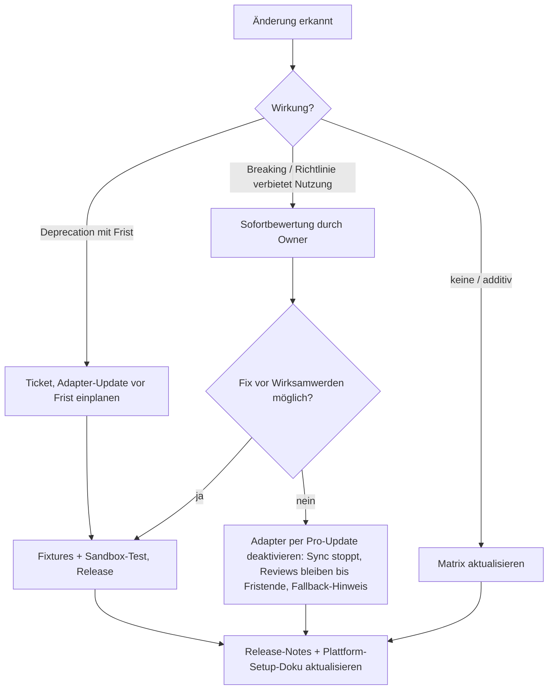

# API-Änderungsroutine (OPS-005)

Status: Entwurf, Stand 2026-11-16.

## Verantwortung

| Rolle | Person |
|---|---|
| Verantwortliche Person (Owner der Routine) | **OFFEN** |
| Vertretung | **OFFEN** |
| Freigabe für Adapter-Deaktivierung | **OFFEN** (Vorschlag: Release-Verantwortliche/r) |

## Quellen, die regelmäßig geprüft werden

| Plattform | Zu beobachten |
|---|---|
| Google Business Profile | Release Notes/Deprecations der Business Profile APIs, API-Policies, Cloud-Console-Hinweise zur OAuth-App |
| Google Places (falls genutzt) | Places-API-Changelog, Preis-/SKU-Änderungen |
| Trustpilot | Developer-Portal (API-Übersicht, Authentifizierung, Content-Refresh-Guidelines), Tarifseiten |
| Trusted Shops / eTrusted | eTrusted-Developer-Doku, Common/Restricted API, Widget-Doku |
| Apple App Store Connect | App-Store-Connect-API-Release-Notes, Apple-Developer-News |
| Google Play | Android-Publisher-API-Changelog, Play-Console-Richtlinien |
| WordPress/WooCommerce | Core-Releases, Woo-Developer-Blog (HPOS, Blocks, Reviews) |

Links: [../providers/matrix.md](../providers/matrix.md), konzept.md §16. Wo möglich Newsletter/RSS abonnieren (an ein Team-Postfach, nicht an Einzelpersonen).

## Rhythmus

- **Monatlich:** alle Quellen sichten (Termin, Checkliste unten), Ergebnis im Änderungsprotokoll der Matrix vermerken.
- **Vor jedem Release:** Matrixzeilen der betroffenen Adapter neu bestätigen (RC-142).
- **Ad hoc:** bei Supporthäufung mit `rc.contract.incompatible`, `rc.data.invalid_payload`, neuen 4xx-Mustern oder Anbieter-Mitteilung.

## Prozess bei Änderung

Regeln
- Deaktivieren eines Adapters löscht **keine** Kundendaten; Aufbewahrungs-/Löschfristen der Plattform gelten weiter und werden vom Adapter auch im deaktivierten Zustand angewendet.
- Es gibt keinen Fern-Abschaltmechanismus im Core (kein Phone-Home). OFFEN: ob der signierte Pro-Lizenz-Snapshot ein Adapter-Sperrflag tragen darf.
- Jede Änderung aktualisiert: Matrix (Prüfstatus + Datum), [../user/platform-setup.md](../user/platform-setup.md), Fixtures (RC-083).

## Checkliste (monatlich)

- [ ] Alle Quellen gesichtet, Datum eingetragen
- [ ] Neue Deprecations mit Frist als Ticket erfasst
- [ ] Richtlinien-/Tarifänderungen mit Produkt besprochen
- [ ] OAuth-App-Status (Verifizierung, Ablauf von Secrets/Zertifikaten) geprüft
- [ ] Supporttickets der letzten 30 Tage auf Anbietermuster geprüft

## Abnahme

Entspricht OPS-005, wenn:

- [ ] eine verantwortliche Person und Vertretung benannt sind (derzeit OFFEN);
- [ ] regelmäßige Prüfung offizieller Änderungsmitteilungen terminiert ist (monatlich + vor Release);
- [ ] der Prozess zum Aktualisieren/Deaktivieren veralteter Adapter dokumentiert ist und Kundendaten dabei nicht verloren gehen.
