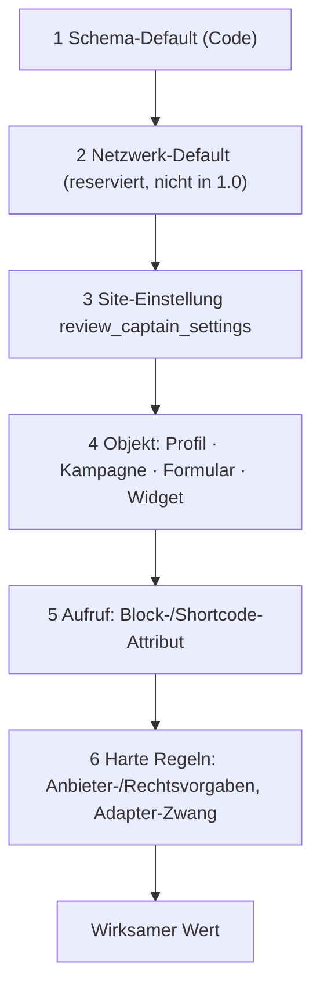

# Vererbung und Overrides (SET-004)

Status: Entwurf zur Abnahme, Stand 2026-11-16.

## 1. Ebenen

Der wirksame Wert wird von oben nach unten aufgelöst; die **unterste gesetzte und gültige** Ebene gewinnt, sofern die Override-Regel des Felds es erlaubt.

- Ebene 2 ist reserviert: in 1.0 gibt es keine Netzwerk-Defaults; jede Site startet mit Schema-Defaults.
- Ebene 5 gilt nur für Felder, die als Attribut dokumentiert sind (`docs/contracts/widget-v1.md`); ein Attribut kann nur Werte setzen, die auch am Widget-Objekt erlaubt sind.
- Ebene 6 kann **jeden** Wert verschärfen, nie lockern (z. B. Trustpilot-Refreshfrist verkürzt `retention_external_days`; Adapter erzwingt `tombstone`; Filter `review_captain_schema_eligible`).

## 2. Override-Arten

| Art | Bedeutung | Beispiel |
|---|---|---|
| **frei** | Objekt darf jeden gültigen Wert setzen | `display.show_date` am Widget |
| **nur verschärfen** | Objekt darf nur in die sichere/strengere Richtung abweichen | `requests.daily_limit` (nur senken), `cooldown_days` (nur verlängern), `reduced_motion` (nur `true`) |
| **nur wenn global erlaubt** | Objekt kann aktivieren, wenn die globale Richtlinie es zulässt | `requests.reminders_enabled` |
| **kein Override** | nur global | Rollen, Fristen, Jobtechnik |

## 3. Matrix

| Feld | Profil | Kampagne (Pro) | Formular | Widget / Attribut | Art |
|---|---|---|---|---|---|
| `general.date_format` | – | – | – | ✓ | frei |
| `general.new_review_status` | – | – | – | – | kein Override |
| `sources.sync_window_*` | ✓ (Pro) | – | – | – | nur verschärfen (Fenster muss innerhalb des globalen liegen) |
| `sources.max_pages_per_run` | ✓ (Pro) | – | – | – | nur verschärfen (≤ global) |
| `sources.pause_after_auth_errors` | – | – | – | – | kein Override |
| `sources.removed_review_behavior` | Adapter | – | – | – | nur verschärfen (`hide` → `tombstone`) |
| `requests.sender_*` | – | ✓ | – | – | frei (Pro validiert Domain) |
| `requests.send_window_*` | – | ✓ | – | – | nur verschärfen |
| `requests.daily_limit` | – | ✓ | – | – | nur verschärfen (≤ global; global bleibt Gesamtgrenze über alle Kampagnen) |
| `requests.cooldown_days` | – | ✓ | – | – | nur verschärfen (≥ global) |
| `requests.reminders_enabled` | – | ✓ | – | – | nur wenn global erlaubt |
| `submissions.enabled` | – | – | – | – | kein Override (globaler Notaus) |
| `submissions.require_consent` | – | – | ✓ | – | nur verschärfen |
| `submissions.min_text_length` | – | – | ✓ | – | frei innerhalb Schema-Grenzen, < max |
| `submissions.max_text_length` | – | – | ✓ | – | nur verschärfen (≤ global) |
| `submissions.allow_title` | – | – | ✓ | – | frei |
| `submissions.honeypot`, `rate_limit_per_hour`, `notify_admin` | – | – | – | – | kein Override |
| `display.show_stars/date/author/avatar`, `date_style`, `empty_text` | – | – | – | ✓ | frei |
| `display.reduced_motion` | – | – | – | ✓ | nur verschärfen |
| `display.load_css` | – | – | – | – | kein Override |
| `privacy.privacy_notice` | – | – | ✓ | – | frei (gleiche kses-Regeln) |
| übrige `privacy.*`, `access.*`, `advanced.*` | – | – | – | – | kein Override |

## 4. Ungültige Overrides

1. Override verletzt Typ/Validierung **oder** Override-Art → Wert der nächsthöheren Ebene wird verwendet.
2. Beim Speichern des Objekts: Feldfehler mit Text „Höchstens {globaler Wert} erlaubt (Einstellungen › {Tab})“, Objekt wird mit dem gültigen Rest gespeichert.
3. Wird die globale Grenze **später** verschärft, bleiben Objektwerte gespeichert, werden aber zur Laufzeit gekappt. Die Objektseite zeigt dann: „Wirksam: 100 (begrenzt durch Einstellungen). Gespeichert: 150.“
4. Unbekannte Attribute in Shortcodes werden ignoriert; ungültige Attributwerte fallen still auf den Widget-Wert zurück (Editor-Vorschau zeigt einen Hinweis).

## 5. Anzeige des wirksamen Werts

- Objektformulare zeigen geerbte Werte als Platzhalter „Standard (aus Einstellungen): Ja“ und einen Schalter „Abweichend festlegen“.
- Widget-Vorschau und Diagnose zeigen je Feld die Herkunft: `Standard` · `Einstellungen` · `Widget` · `Attribut` · `Vorgabe der Quelle`.
- Technische Auflösung über eine zentrale Funktion (Vorschlag: `ReviewCaptain\Settings\Resolver::effective( string $tab, string $key, ?Context $ctx )`), die Wert **und** Herkunft liefert; kein Code liest Objekt-Overrides an der Auflösung vorbei.

## Abnahme

Entspricht SET-004, wenn:

- [ ] die Reihenfolge Default → Site → Objekt → Attribut → harte Regeln eindeutig beschrieben ist;
- [ ] jedes überschreibbare Feld eine Override-Art hat und alle anderen Felder als „kein Override“ markiert sind;
- [ ] ungültige Overrides kontrolliert auf die nächsthöhere Ebene zurückfallen und die UI den wirksamen Wert samt Herkunft zeigt;
- [ ] Unit-Tests die Matrix (inkl. später verschärfter globaler Grenzen) abdecken.
