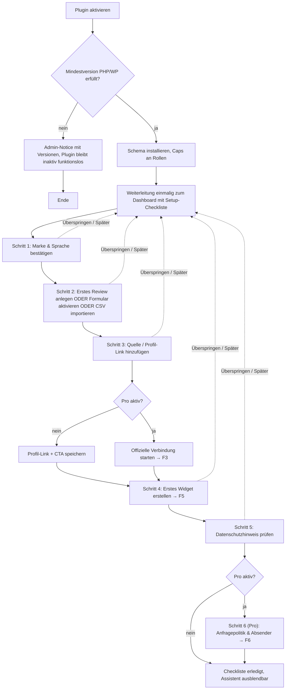
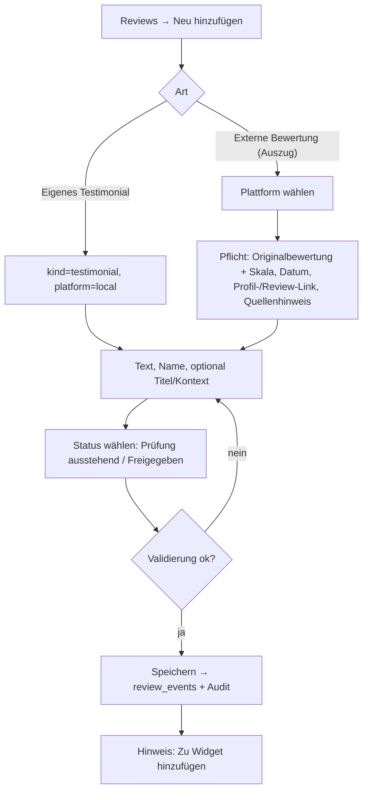
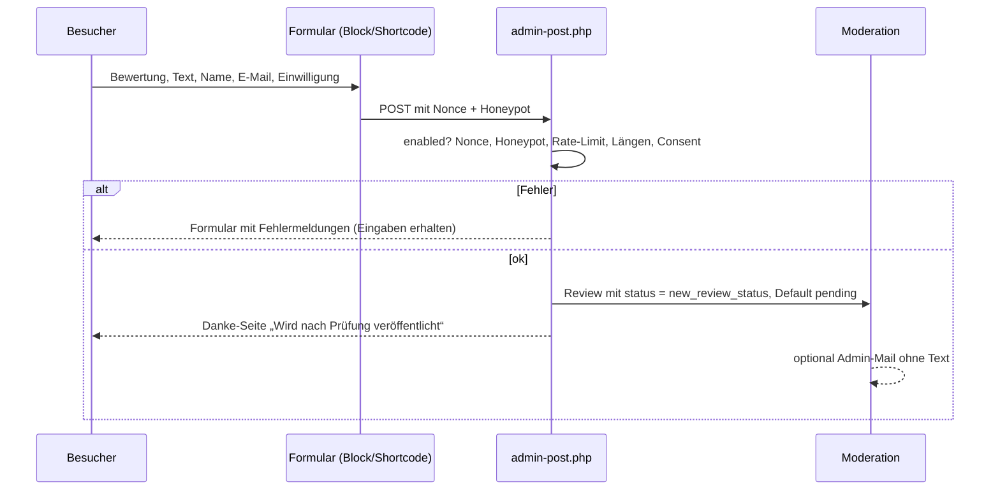
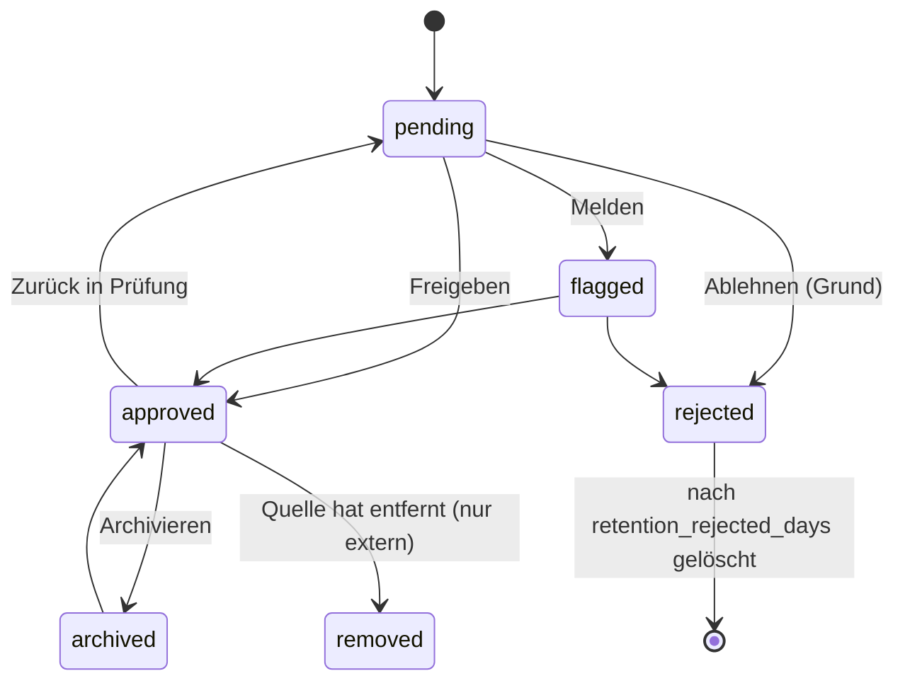
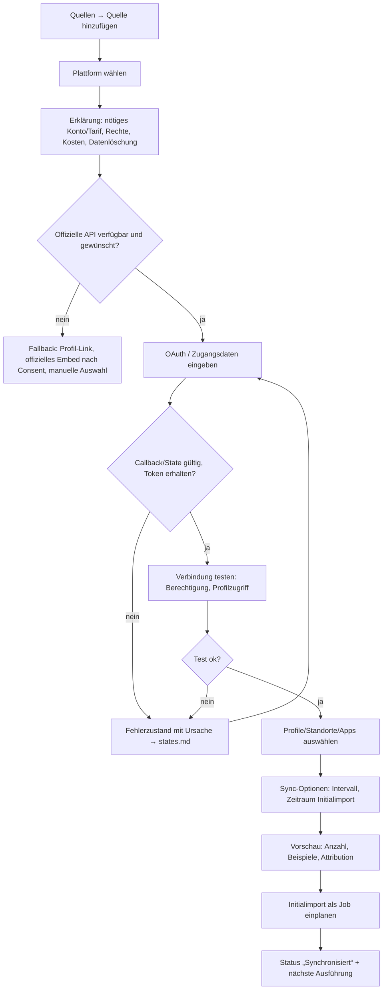
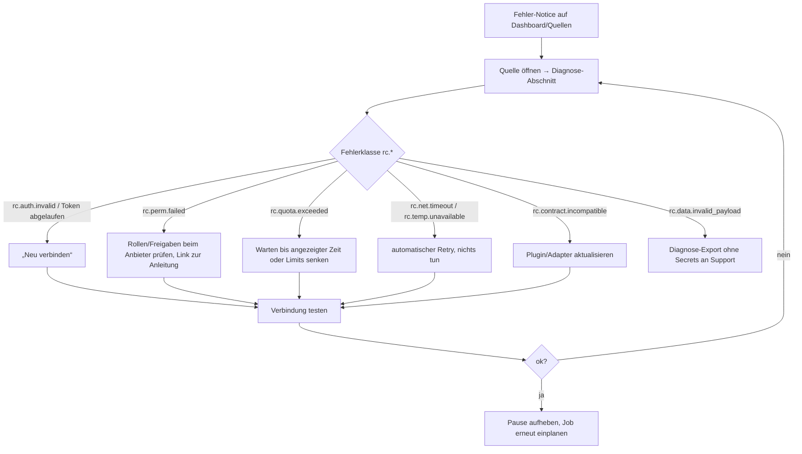
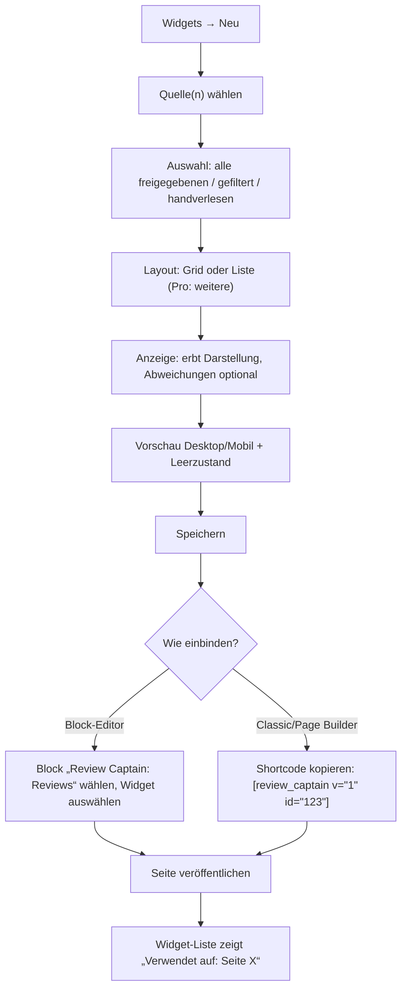
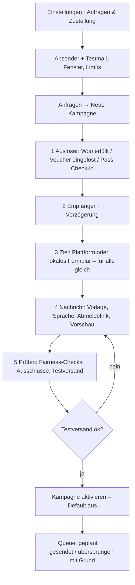
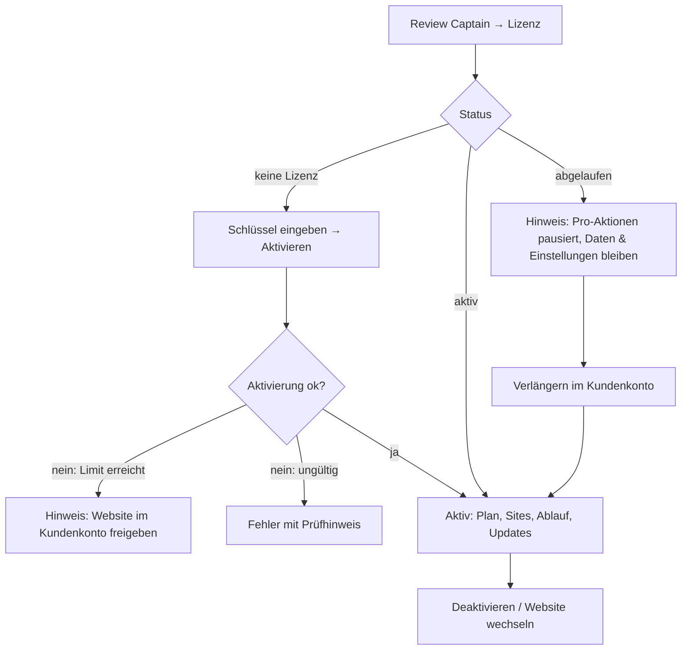
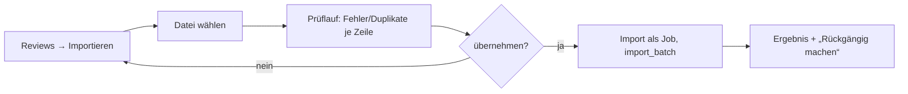

# Nutzerabläufe (UX-002)

Status: Entwurf zur Abnahme, Stand 2026-11-16. Grundlage: konzept.md §8, §9, §17; [wireframes.md](wireframes.md); [states.md](states.md).
Pro-Schritte sind mit **(Pro)** markiert. Alle Abläufe funktionieren ohne Frontend-JavaScript; Admin-JS ist progressive Verbesserung.

## F1 Erstinstallation und Setup-Assistent

Wiederaufnehmbar, jeder Schritt überspringbar, keine externe Verbindung wird automatisch aufgebaut. Fortschritt in Option `review_captain_onboarding` (Vorschlag, nicht Teil von `review_captain_settings`).

Regeln: Checkliste bleibt auf dem Dashboard, bis alle Schritte erledigt oder bewusst ausgeblendet sind. Überspringen speichert nichts und verändert keine Defaults.

## F2 Review erfassen

### F2a Manuell (eigenes Testimonial oder externer Auszug)

### F2b Lokale Einreichung über Formular

### F2c Moderation

## F3 Plattform verbinden (Pro)

## F4 Syncfehler beheben

Garantie im gesamten Ablauf: vorhandene Reviews bleiben sichtbar; nichts wird wegen eines Fehlers gelöscht.

## F5 Widget veröffentlichen

## F6 Anfrage konfigurieren (Pro)

Keine Verzweigung nach Rating/Zufriedenheit; Refund/Absage/Opt-out stoppen offene Einladungen.

## F7 Pro-Lizenz verwalten (Pro)

## F8 CSV-Import mit Prüflauf (Core)

Details: [../migration.md](../migration.md).

## Abnahme

Entspricht UX-002, wenn:

- [ ] Erstinstallation, Review erfassen, Plattform verbinden, Syncfehler beheben, Widget veröffentlichen, Anfrage konfigurieren und Pro-Lizenz verwalten als Flows vorliegen (F1–F7) und mit Produkt abgestimmt sind;
- [ ] jeder Flow Fehler-/Abbruchpfade enthält, die auf einen Zustand in [states.md](states.md) verweisen;
- [ ] kein Flow eine externe Verbindung automatisch aufbaut, Reviews bei Fehlern löscht oder nach Bewertung filtert;
- [ ] die Flows in den Usability-Tests (UX-006) verwendet wurden.
