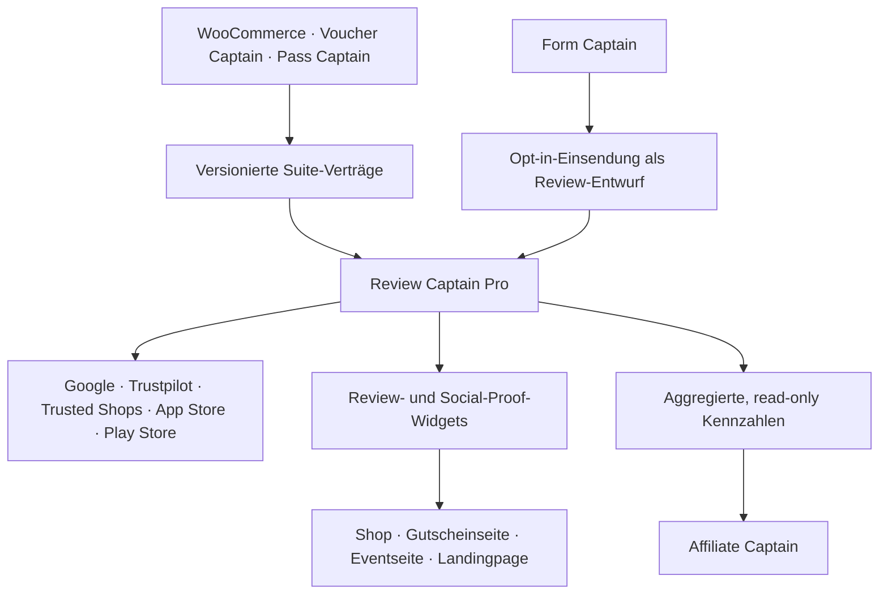
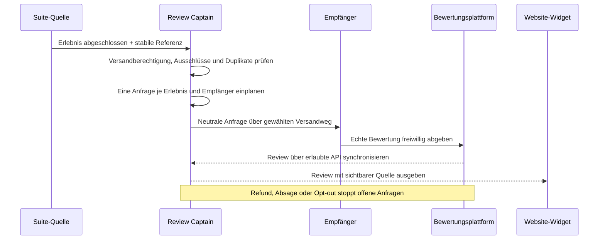
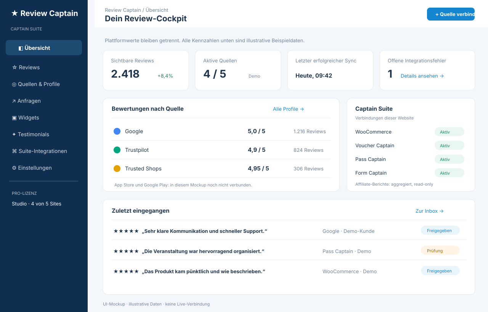
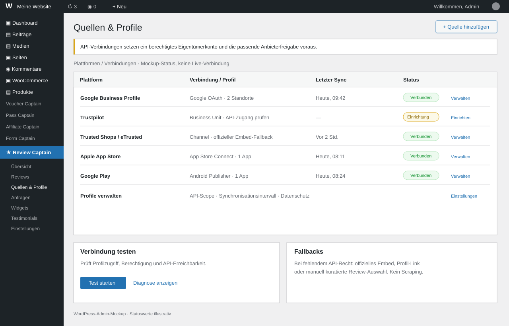
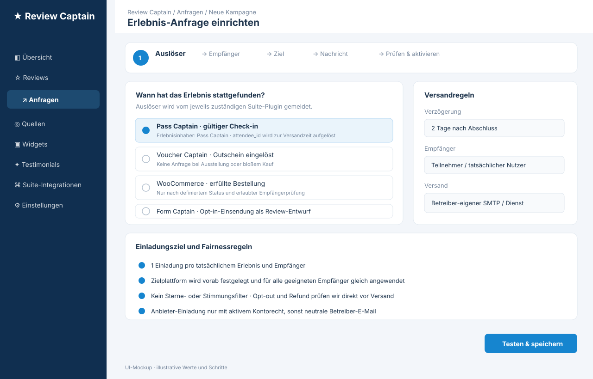
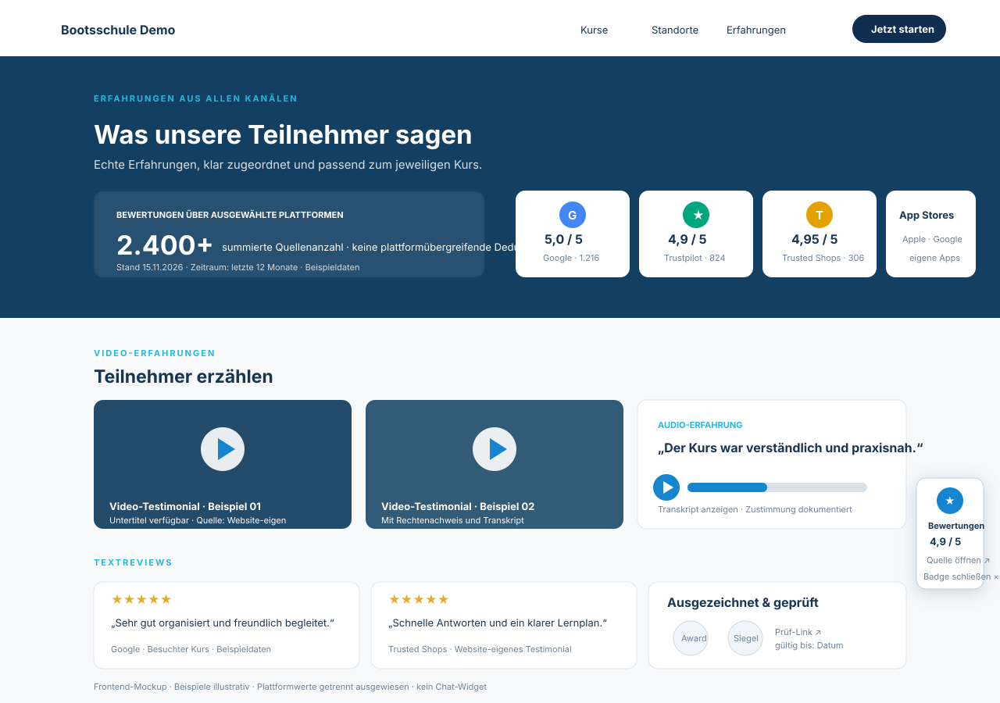

# Review Captain – Produktkonzept

**Status:** Konzept zur Abstimmung  
**Stand:** 15. November 2026  
**Produktname:** Review Captain  
**Repository:** `hastla007/wp-reviewmaster`  
**WordPress-Kernplugin:** `review-captain` (Vorschlag)  
**Premium-Add-on:** `review-captain-pro` (Vorschlag)  
**Lizenzserver-Produktschlüssel:** `review-captain-pro` (muss im WP License Captain-Katalog angelegt werden)  
**Rechte-Präfix:** `review.`

> Dieses Dokument ist die Produkt- und Umsetzungsgrundlage, keine Zusage, dass Anbieterzugänge, API-Freigaben oder Nutzungsrechte bereits vorliegen. Vor jeder Plattform-Veröffentlichung sind die jeweiligen API-, Marken-, Cache-, Datenschutz- und Tarifbedingungen erneut zu prüfen.

## Lizenzmodell und Produktabgrenzung

WP License Captain (License Captain Server) ist ein eigenständiges, separat verkauftes Server-Plugin und kein Bestandteil von Review Captain Pro. Review Captain Pro enthält nur die Client-Komponente, die wir zur Prüfung der eigenen PRO-Lizenzen an unserem Lizenzserver verwenden. Diese interne Lizenzierungsinfrastruktur hat für den Kunden keinen eigenständigen Produktnutzen und wird vor dem Kauf nicht als PRO-Leistung kommuniziert. Käufer benötigen keinen eigenen License Captain Server, um Review Captain Pro zu nutzen.

## 1. Zusammenfassung

Review Captain bündelt authentische Kundenbewertungen aus mehreren Plattformen in WordPress, verwaltet ihre Anzeige und hilft Unternehmen, nach einer echten Kundeninteraktion fair um Feedback zu bitten. Das Plugin soll mindestens Google, Trustpilot, Trusted Shops, Apple App Store und Google Play als Quellen unterstützen.

Das Produkt besteht aus einem eigenständig nützlichen, kostenlosen Kern und einem separat lizenzierten Pro-Add-on:

- **Review Captain (Free):** lokale Reviews und manuell kuratierte externe Bewertungen, einfache Bewertungsdarstellung, Quellenangaben, Block/Shortcode, Basisstatistiken, Datenschutz- und Moderationswerkzeuge.
- **Review Captain Pro:** offizielle Plattform-Verbindungen und Synchronisierung, mehrere Quellen und Profile, automatische Review-Anfragen, erweiterte Widgets, Filter und Auswertungen, WooCommerce- und Captain-Suite-Automationen einschließlich optionaler Form-Captain-Formularbrücke, Export sowie Prioritätsfunktionen.

Das wichtigste Produktversprechen ist **eine sauber attribuierte, schnelle, barrierearme Review-Erfahrung in WordPress**, die externe Bewertungen und lokale Kundenstimmen in einer konsistenten Oberfläche zusammenführt – ohne Scraping, irreführende Zusammenfassung oder künstliche Bewertungen.

## 2. Zielgruppen und Anwendungsfälle

### Zielgruppen

1. **WooCommerce-Händler:** Social Proof auf Shop-, Produkt-, Kassen- und Dankeseiten sowie zeitgesteuerte Bewertungsanfragen nach Versand oder Leistung.
2. **Lokale Betriebe und Dienstleister:** Google- und Trusted-Shops-/Trustpilot-Profilbewertungen auf Start-, Kontakt- und Leistungsseiten.
3. **App-Hersteller:** Rezensionen aus Apple App Store und Google Play auf Produkt-, Landing- und Supportseiten anzeigen.
4. **Agenturen:** dieselbe Bedienlogik über mehrere Kundenwebsites, mit Rollen, wiederverwendbaren Vorlagen und sauberer Lizenzverwaltung.
5. **Captain-Suite-Kunden:** Reviews an Gutschein-, Ticket- und Affiliate-Prozesse anschließen, ohne dieselben Integrationen mehrfach einzurichten.

### Kernprobleme

- Kunden müssen zwischen Plattform-Dashboards wechseln, um Reviews zu lesen und auf der Website zu verwenden.
- Vorhandene Widgets unterscheiden sich stark im Design, laden externe Skripte oder haben harte Grenzen in Free-Tarifen.
- Bewertungen von App-Stores und Shop-Plattformen landen selten in einem einheitlichen WordPress-Workflow.
- Manuelle Review-Anfragen sind fehleranfällig; automatische Anfragen brauchen klare Ereignisse, Einwilligung, Frequenzgrenzen und Ausschlüsse.
- Sterne-Schema und Zusammenfassungen können bei Plattform-Reviews rechtlich und richtlinienseitig heikel sein, wenn externe Bewertungen als eigene Reviews ausgegeben werden.

## 3. Markt- und Wettbewerbsanalyse

### Produktmuster und Positionierung

Die Marktanforderungen werden anonymisiert und nach Funktion bewertet: Review-Widgets, lokale Moderation, Mehrplattform-Aggregation, verifizierte Erfahrungen, Einladungsautomatik und datensparsame Speicherung. Keine Namen oder URLs konkurrierender Review-Plugins bzw. Aggregationsdienste in Vergleichstabellen. **Technisch integrierte Bewertungsplattformen** und ihre offiziellen APIs bleiben als Provider ausdrücklich benannt.

### Produktchance

Review Captain sollte nicht mit „noch mehr Widget-Layouts“ konkurrieren. Die Differenzierung liegt in vier Dingen:

- **Suite-Verbindungen:** Review-Anfrage am passenden Punkt in Voucher, Pass, WooCommerce oder Affiliate auslösen.
- **Betriebsmodell in WordPress:** Profile, Sync-Zustand, Review-Widgets und Anfrageprotokoll zentral im Dashboard.
- **Quellentreue:** Herkunft, Direktlink, Bewertungsart (Service/Produkt/App), Veröffentlichungsdatum und Synchronisationszeit bleiben sichtbar.
- **Kontrollierte Automatisierung:** kein Review-Gating (zufriedene Käufer zu öffentlichen Plattformen und unzufriedene nur intern lenken), keine Belohnung für positive Reviews, keine Anfrage ohne gültige Rechtsgrundlage.

### Konkrete Funktionslücken gegenüber Wettbewerbern

Der aktuelle Konzeptumfang ist stark bei Plattform-Aggregation und Suite-Automatisierung. Gegen einzelne etablierte Plugins fehlen aber noch Funktionen aus den Bereichen Produktreviews, UGC und Kampagnen:

| Funktion, die Wettbewerber anbieten | Beispiel aus dem Markt | Status im Review-Captain-Konzept | Einschätzung |
|---|---|---|---|
| **Foto- und Video-Reviews** | vergleichbare Lösungen unterstützt Bilder/Videos; vergleichbare Lösungen hat Bild-Reviews und Galerie. | Nicht vorgesehen; das lokale Review-Formular sammelt bisher Text und Rating. | **Hohe Priorität für Phase 2.** Sichtbarer Social Proof. Mit Moderation, Größenlimit, Einwilligung, Malware-/Dateitypprüfung und sauberer Aufbewahrung umsetzen. Videos zunächst externe Einbettungslinks statt eigener Hosting-/Transcoding-Infrastruktur. |
| **Fragen und Antworten auf Produktseiten** | vergleichbare Lösungen hat ein Q&A-Modul für Fragen und Antworten rund um Produkte. | Nicht vorgesehen. | **Gute WooCommerce-Ergänzung.** Als eigenes Q&A-Objekt getrennt von externen Bewertungen halten; Händlerantworten und Moderation unterstützen. |
| **Verifizierter Kauf / verifizierte Erfahrung** | WooCommerce/vergleichbare Lösungen kann Kundenreviews mit Bestellbezug und Verifizierungsablauf darstellen; vergleichbare Lösungen bietet Review-Verifizierung. | Review Captain unterscheidet bereits eigene/externe Reviews, spezifiziert aber noch kein einheitliches, belegbares Verifizierungskennzeichen für lokale Reviews. | **Wichtig für Glaubwürdigkeit.** Nur als „Kauf verifiziert“ kennzeichnen, wenn das Quellplugin eine echte bezahlte/erfüllte Bestellung geprüft hat. „Teilnahme bestätigt“ separat davon benennen. |
| **Review-Formular für mehrere Positionen** | vergleichbare Lösungen bietet ein Formular, mit dem ein Kunde mehrere gekaufte Produkte in einer Sitzung bewerten kann. | Anfrage- und Widgetregeln sind vorgesehen; gebündelte Review-Abgabe pro Bestellung ist nicht beschrieben. | **Hohe Priorität im WooCommerce-Flow.** Eine E-Mail pro Erlebnis kann dennoch mehrere klar getrennte Produktbewertungen erfassen; keine Bewertung vorauswählen oder erzwingen. |
| **Kundenfragen, Community-Aktionen und Autorenfunktionen** | vergleichbare Lösungen bietet Upvotes, Melden/Übersetzen und Aktualisieren von Reviews durch Autoren; individuelle Review-Formulare mit Feldbedingungen. | Basisformular, Filter und Moderation sind vorgesehen, nicht aber Upvotes, Autorenbearbeitung, Meldeprozess oder benutzerdefinierte Feldgruppen. | **Auswahl für später.** Melden und Händlerantwort sind sinnvoll; Upvotes/öffentliche Übersetzung nur bei klarer Moderation, Missbrauchsschutz und Mehrwert. |
| **Mehr Einladungswege** | vergleichbare Lösungen nennt E-Mail-Erinnerungen, manuelle WhatsApp-Einladungen und bestellbezogene QR-Codes für Review-Formulare. | Automatische Einladungen und Versandqueue sind vorgesehen; WhatsApp, QR-Kampagnen und mehrere Produkte pro Formular fehlen. | **Gute Suite-Chance.** Feedback-QR auf Gutschein-PDFs oder Eventmaterial als eigener QR-Link; niemals den Sicherheits-/Einlass-QR eines Tickets wiederverwenden. WhatsApp nur über offiziellen Click-to-Chat oder freigegebenen Messaging-Anbieter. |
| **Google Shopping Produktreview-Feed** | vergleichbare Lösungen bietet XML-Feeds für Google Shopping Product Ratings/Reviews an. | Nicht vorgesehen. | **Potenziell starke WooCommerce-Pro-Funktion**, aber erst nach Prüfung der Google Merchant Center Teilnahmebedingungen, Produktzuordnung, Herkunfts- und Verifizierungsanforderungen planen. Nicht mit Google Business Profile Reviews verwechseln. |
| **Mehr externe Plattformen** | vergleichbare Lösungen deckt neben Google u. a. Facebook, Yelp, Amazon, TripAdvisor, Booking.com und weitere Portale ab; Trustpilot bietet eigene Widgets/Marketingfunktionen. | Startumfang ist bewusst auf Google, Trustpilot, Trusted Shops, App Store und Play Store begrenzt. | **Kein MVP-Blocker.** Provider-Architektur muss erweiterbar sein. Plattform nur ergänzen, wenn offizieller Datenzugang, stabile Nachfrage und rechtmäßige Darstellung gesichert sind. |
| **Vorlagen- und Sprachkomfort** | vergleichbare Lösungen erlaubt öffentliche Textanpassung und Übersetzungsintegrationen; vergleichbare Lösungen unterstützt mehrsprachige Erinnerungen und angepasste E-Mails. | Vorlagen, Locale und Übersetzungsgrundlage sind vorgesehen; mehrsprachige Kampagnenvorschau, automatische Übersetzungszuordnung und Übernahme der WPML/Polylang-Produktzuordnung sind nicht detailliert. | **Vor Pro-Release konkretisieren.** Kampagnensprache aus Bestellung/Teilnehmer wählen, fehlende Übersetzung sichtbar melden, niemals Reviewtexte automatisch verändern. |
| **Review-Migration und Tagging** | vergleichbare Lösungen beschreibt Import/Export, Review-Tags und Review-Verwaltung. | CSV-Export ist vorgesehen; Import-/Migrationsassistent und Tags/Labels für interne Moderation fehlen. | **Wichtig beim Wechsel.** Erstimport aus WooCommerce, vergleichbare Lösungen und vergleichbare Lösungen mit Vorschau, Duplikaterkennung und Rollback planen; Plattformquellen nicht als native Woo-Kommentare importieren. |
| **Mehr Widgets und Builder-Komponenten** | vergleichbare Lösungen setzt auf vorgefertigte Layouts; vergleichbare Lösungen gibt Template-Kontrolle und Blocks/Shortcodes. | Grid/List und Pro-Carousel, Badge, Trustbar sowie Gutenberg/Shortcodes sind vorgesehen. | **Kein grundlegender Funktionsmangel**, aber Elementor/Divi-Integration, Farb-/Typografie-Vorlagen, Slider-Steuerung und echte Frontend-Vorschau sollten als Ausbaupunkte aufgenommen werden. |

### Was davon in die Roadmap sollte

**Vor dem ersten Pro-Verkauf ergänzen oder verbindlich entscheiden:**

1. Import/Migration mit Vorschau für WooCommerce und verbreitete lokale Review-Plugins.
2. Verifizierungsregeln für „Kauf verifiziert“ und „Teilnahme bestätigt“.
3. Mehrsprachige Review-Anfragevorlagen mit Produkt-/Teilnehmer-Locale.
4. Gebündelte Anfrage-/Formularlogik für mehrere Produkte bzw. Eventpositionen.
5. Aktuelle Merchant-Center-Anforderungen für einen optionalen Produktreview-Feed ermitteln.

**Als differenzierende Folgefunktionen aufnehmen:**

- Foto-Reviews mit Galerie; Video zuerst als datenschutzfreundliche externe Einbettung.
- Produkt-Q&A und Händlerantworten.
- Eigene Feedback-QR-Codes für Voucher Captain und Pass Captain.
- Review-Tags, Melden/Autorenkorrektur und ausgewählte Community-Funktionen.
- Weitere Plattformadapter jenseits der initialen fünf – abhängig von Nachfrage und offiziellen API-/Lizenzrechten.

**Bewusst nicht übernehmen:** Rabatte, Gutscheine oder andere Vorteile für Bewertungen auf externen Plattformen; bedingte Weiterleitung je nach Sternen; Rezensionstexte verändern; fremde Reviews ungeprüft in Produktfeeds oder WooCommerce-Sterne kopieren. Foto/Video-Inhalte, Import und Verifizierung müssen Moderation, Quellenangabe und Löschrechte mitliefern.

Die Wettbewerber-Funktionslisten und Anbieter-Tarife ändern sich regelmäßig. Vor Preis- und Launch-Entscheidungen muss ein dokumentierter Live-Vergleich der Free- und Paid-Tarife erstellt werden; Angaben in diesem Konzept sind qualitative Marktbeobachtungen, keine Preisempfehlung.

## 4. Plattformen und Integrationswege

Eine Plattform-Integration besteht aus **Verbindung**, **Import-/Sync-Vertrag**, **normalisiertem Review-Datensatz**, **Quellenkennzeichnung**, **Widget-Ausgabe**, **Fehlerbehandlung** und – falls offiziell erlaubt und technisch unterstützt – **Antwort- oder Einladungsaktionen**. Jede Plattform ist ein Adapter; ein Ausfall soll nicht die übrigen Quellen blockieren.

| Plattform | Bevorzugter Integrationsweg | Anforderungen / Grenzen | MVP-Entscheidung |
|---|---|---|---|
| **Google** | Google Business Profile API für verifizierte und vom Kunden verwaltete Standorte (OAuth); Place Details API nur als begrenzter öffentlicher Fallback. | Business Profile Reviews setzen autorisierte Konten und verifizierte Standorte voraus. Places API zeigt in Place Details höchstens fünf Reviews; Rezensionstext- und Review-Felder liegen in einer teureren SKU-Stufe. Google-Inhalte müssen mit Quelle/Attribution nach den jeweils aktuellen Richtlinien dargestellt werden. Keine Scraping- oder HTML-Import-Lösung. | Pro: OAuth-Verbindung zu verwalteten Standorten und paginierter Sync. Free: Profil-Link und manuell gepflegte Auswahl, keine Google-Scrapes. |
| **Trustpilot** | Offizielle Trustpilot-Widgets, wo für den Tarif zulässig; für eigene native Widgets Business-/Data-Solutions-API mit API-Key bzw. OAuth je Endpunkt/Tarif. | Öffentliche und private APIs unterscheiden sich. Private Endpunkte erfordern OAuth und Berechtigungen. Für angezeigte API-Inhalte gilt laut Trustpilot eine maximale Cache-Aktualisierung von 24 Stunden; Löschungen und Attribution sind zu berücksichtigen. API-Verfügbarkeit darf nicht als in jedem Trustpilot-Tarif garantiert werden. | Pro: Zugangsdaten und Business-Unit verbinden, sofern der Kunde API-Recht hat; andernfalls offizielles Widget/Profil-Link. |
| **Trusted Shops / eTrusted** | eTrusted Customer Reviews API für berechtigte Kunden; offizieller Trustbadge-/Review-Widget-Code als Einbettungsoption. | API-Zugang und Berechtigungen hängen vom Trusted-Shops-Konto/Produkt ab. Öffentliche Common API ist nicht gleichbedeutend mit vollständigem Zugriff auf private Reviews; Trusted Shops stellt eigene APIs und Widgets bereit. Shop-ID/Kanal und API-Credentials sind nötig. | Pro: eTrusted-API-Verbindung nach erfolgreichem Credential-Test; Free: Profil-Link bzw. Embed-Code. Anbieterfreigabe und Vertrag vor Launch abklären. |
| **Apple App Store** | App Store Connect API, `customerReviews` je App. | App-Store-Connect-Teamzugriff, App-Ressourcen-ID sowie API-Key/Issuer-ID/Key-ID (JWT) nötig. Abruf nur für Apps, die der Kunde verwaltet; Territory, Bewertung und Version können filterbar sein. Antworten sind getrennte Endpunkte und brauchen Rechte. | Pro: read-only Import und Sync für eigene Apps; Antworten später als eigener Umfang. |
| **Google Play** | Google Play Developer API, Android Publisher `reviews.list`; Antwort-Endpunkt optional später. | OAuth-/Service-Account-Zugriff auf Play Console des App-Eigentümers; Paketname. Zugriff gilt nur für eigene Apps, nicht für beliebige Wettbewerber-Apps. API-Scopes und Google Play Bedingungen beachten. | Pro: read-only Import der eigenen App-Reviews; Antwort-Funktion nach MVP. |

### Normalisiertes Review-Modell

Minimalfelder:

- interne ID, Plattform und eindeutige Plattform-ID;
- Profil-/Kanal-ID und optionale Produkt-/App-Zuordnung;
- Review-Typ (Service, Produkt, App oder lokal), Sterne/Rating-Skala, Titel, Text;
- öffentlicher Anzeigename/Avatar-URL nur wenn Plattform das erlaubt;
- Erstellungs-/Änderungsdatum, Sprache, Versions-/Produktbezug;
- Plattform-Link, Quellenlabel und eventuell Anbieter-Attributionshinweis;
- Antwortstatus bzw. öffentliche Antwort, falls API dies zulässt;
- Importzeit, zuletzt erfolgreich geprüft, Lösch-/Widerrufsstatus;
- Status „sichtbar“, „ausgeblendet“, „archiviert“; lokale Moderation darf nie die Quelle oder Bewertung verfälschen.

Review-Kopien dürfen nur so lange und in dem Umfang gespeichert werden, wie Plattformbedingungen es erlauben. Das Modell muss eine Löschung bzw. Entfernung aus dem Cache abbilden; Reviews werden nicht in Schema-Markup umetikettiert, wenn sie nicht auf der eigenen Website abgegeben wurden.

## 5. Funktionsumfang

### Free – kostenloser Kern

Free muss als eigenständiges Plugin sinnvoll bleiben und darf keine Lizenzprüfung benötigen.

- WordPress-eigene Reviews/Testimonial-Datensätze anlegen und verwalten.
- Externe Review-Links und einzelne, vom Websitebetreiber manuell ausgewählte Review-Auszüge mit Quelle, Direktlink, Datum und Originalbewertung pflegen.
- Sterne/Score auf der ursprünglichen Plattformskala anzeigen; Quelllogo/Quellenlabel neben jeder externen Bewertung.
- Review-Sammlung, Such-/Statusfilter, einfache Moderation und manuelle Einträge.
- Ein Basis-Grid/Listen-Widget mit responsivem Layout sowie Review-Card-Block und Shortcode.
- Einfache, manuell gepflegte Text-Testimonials, klar als Website-eigene Erfahrungsberichte gekennzeichnet und von Plattform-Reviews getrennt.
- Manuelle Einbindung von Bewertungsprofilen („Auf Google/Trustpilot bewerten“) mit konfigurierbarem CTA.
- Lokale Review-Einreichung mit Formular, Spam-Schutz (Nonce, Honeypot, Rate-Limit), Moderationswarteschlange und Opt-in-Feld.
- Basis-Summary nur aus den angezeigten/ausgewählten Datensätzen und getrennte Kennzahl je Plattform; kein irreführender plattformübergreifender „Gesamtscore“ ohne klare Berechnung/Quellenangabe.
- Schema-Markup nur für Reviews, die auf der eigenen Website gesammelt wurden und nach Schema-/Google-Richtlinien ausgezeichnet werden dürfen; keine selbstbezogenen Unternehmensbewertungen als Rich-Result-Abkürzung.
- WordPress-Datenexport/-löschung, Datenaufbewahrungseinstellungen, Rollen/Rechte, Übersetzungsgrundlage und Multisite-Trennung.
- Keine externe API-Abhängigkeit auf dem Frontend und keine Drittanbieter-Skripte ohne explizite Aktivierung.

### Pro – separat lizenziertes Add-on

- Offizielle OAuth/API-Verbindungen für die fünf unterstützten Quellen, jeweils einzeln aktivierbar.
- Mehrere Geschäftsprofile, Standorte, Shops oder Apps pro Website.
- Zeitgesteuerter Import mit Delta-Sync, Cron/Action-Scheduler-Jobs, Status, Retry und Ratenbegrenzung.
- Plattformübergreifende Review-Inbox, mit Quellen-, Typ-, Zeitraum-, Sterne-, Sprache-, Produkt- und Sichtbarkeitsfiltern.
- Automatische Review-Anfragen nach Kauf, Versand, Gutscheinverwendung oder Eventende über freigegebene Integrationspunkte. Vorlagen, Verzögerung, Ruhezeit, Ausschlussregeln, Opt-out und Audit.
- WooCommerce-Integration für Order-Status/Ereignisse und Produktzuordnung, mit HPOS/Classic/Blocks-Checkout-Kompatibilität, ohne unnötige Übermittlung von Bestelldaten.
- Antwort- oder Reply-Hilfen nur bei offizieller Plattform-API und freigegebenen Rechten. Keine automatische Veröffentlichung im MVP; Antworten vor Versand manuell bestätigen.
- Zusätzliche Widgets: Karussell, Badge/Score, Masonry, Produkt-/App-Rating, Trustbar, ausgewählte Testimonials, CTA; Gutenberg-Blocks, Widgets/Shortcodes und optionale Builder-Integrationspunkte.
- Design-Controls für Layout, Anzahl, Sterne, Datum, Quelle, Sprache und „Mehr laden“; barrierearme Tastaturbedienung und reduced-motion.
- Analytics: Reviews im Zeitverlauf, Quelle, App-/Produktbezug, Verteilung und Anfrage-/Antwortstatus. Kein Scraping von Wettbewerber-Reviews und keine KI-Sentimentanalyse im MVP.
- **Social-Proof-Wall und Testimonial-Studio:** Text-, Bild-, Video- und Audio-Erfahrungsberichte mit Name/Bezeichnung, Einwilligungs-/Nutzungsrechtsnachweis, optionaler Sternebewertung und Zuordnung zu Produkt, Kurs, Event, App oder Seite. Eigene Testimonials bleiben als eigener Inhaltstyp erkennbar und werden nicht als Google-/Trustpilot-Review ausgegeben.
- **Multimedia-Layouts:** Video-Testimonials, Audio-Erfahrungen und Text-Reviews als getrennte oder kombinierte Reihen/Karussells; Vorschaubild, Untertitel/Transkript, Quellen-/Erfahrungslabel und manuelle Moderation.
- **Plattform-Bewertungsleiste:** pro Quelle getrenntes Logo, Rating mit Originalskala, Bewertungsanzahl, Zeitraum/Stand und Link zum Profil. Eine Gesamtanzahl kann als Summe der ausgewählten Plattform-Zähler angezeigt werden, ausdrücklich als Summe und mit Hinweis, dass plattformübergreifende Doppelbewertungen nicht dedupliziert werden. Kein Gesamt-Sterneschnitt ohne klar offengelegte, nachvollziehbare Berechnung.
- **Vertrauenssignale:** verwaltbare Auszeichnungen, Zertifikate, Gütesiegel und Käuferschutz-Hinweise mit Herausgeber, Verleihungs-/Ablaufdatum, Verifizierungslink und korrekter Markenfreigabe. Offizielle Anbieter-Badges werden per zulässigem Embed oder freigegebenem Asset eingebunden.
- **Schwebendes Trust-Badge:** optionaler, seitenbezogener, mobil anpassbarer Rating-/Käuferschutz-Teaser mit Quellenlink, Schließen-/Minimieren-Steuerung und Regeln gegen Überlagerung anderer Sticky-Elemente.
- CSV-Export mit Spreadsheet-Formel-Schutz, planbare Reports und erweiterte Moderationsregeln.
- Multi-Profile-Sync, Import-Logs, Integrationsdiagnose und Support-Tools.
- Captain-Suite-Adapter für Voucher Captain, Pass Captain und Affiliate Captain sowie optionaler Form-Captain-Formularadapter (Details Abschnitt 7). Form Captain Core reicht aus; auf Review-Seite ist das Entitlement review.suite_integrations erforderlich.
- White-Label ist kein Startversprechen. Zunächst soll in allen Plänen derselbe Pro-Funktionsumfang enthalten sein; Pläne unterscheiden sich nach der Lizenzregel der Suite anhand Live-Websites und Support.

### Bewusst nicht im MVP

- Scraping von Google Maps, Trustpilot, Trusted Shops oder App Stores.
- Anzeigen beliebiger Konkurrenz-Profile oder nicht autorisierter Apps über private API-Zugänge.
- „Review-Gating“, bei dem nur zufriedene Kunden zur öffentlichen Bewertungsplattform geleitet werden.
- Kauf/Anreiz positiver Bewertungen, automatisches Veröffentlichen manipulierter Reviews, Bewertungstexte verändern oder den Quellennachweis entfernen.
- Plattformübergreifende Durchschnittsnote ohne ausdrückliche Skalen-Normalisierung und verständliche Erklärung.
- KI-generierte Kundenrezensionen oder automatisches Verfassen/Publizieren von Antworten.
- Garantierte Sterne-Rich-Snippets für importierte Reviews.
- Cloud-SaaS-Konto als Voraussetzung für den WordPress-Kern.

## 6. Free/Pro, Preise und Lizenzierung

### Produktaufteilung

Captain Suite setzt auf ein **vollwertiges kostenloses Kern-Plugin** und ein separates **Pro-Add-on**. Review Captain soll dasselbe Modell verwenden:

| Bestandteil | Repository / Ordner | Aufgabe |
|---|---|---|
| Review Captain Core | `hastla007/wp-reviewmaster`, Plugin-Slug Vorschlag `review-captain` | lokale Reviews, manuelle externe Review-Kuration, Anzeige, Datenexport/-löschung, Integrationsverträge |
| Review Captain Pro | `hastla007/captain-pro/addons/review-captain-pro/` | API-Verbindungen, automatischer Sync/Anfragen, erweiterte Widgets/Reports und lizenzierte Funktionen |
| Lizenzsystem | `hastla007/wp-license` | Lizenzprodukte, Aktivierung, Entitlements, Updates und Websites-Limits |

Das Core-Plugin kennt das Pro-Add-on nicht und enthält keinen Lizenzclient. Pro klinkt sich über stabile, dokumentierte Core-Hooks ein. Bei fehlendem oder abgelaufenem Entitlement bleiben die Core-Funktionen und vorhandenen Daten nutzbar; nur Pro-Aktionen werden deaktiviert. Lesende Anzeige und Export bereits vorhandener Reviews bleiben möglich.

### Lizenzvertragsvorschlag

- **Produktschlüssel:** `review-captain-pro`; Rechtepräfix `review.`. Beide müssen im Lizenzserver-Katalog ergänzt und mit `wp-license`/Captain Pro abgestimmt werden.
- Lizenzclient und Updateprozess aus `wp-license` exportieren; Add-on-Kernel und Namespaces in Captain Pro gemäß Architektur verwenden.
- Plugin-Version, Core-Mindestversion, Textdomain und Update-URI nach dem bestehenden Captain-Pro-Buildstandard.
- Planschlüssel: solo (1 Live-Website), studio (5), agency (25); Support-Level standard bzw. priority. Dieselben Site-Limits und Plan-IDs wie Form Captain, Pass Captain Pro und Voucher Captain Pro verwenden. Produktpreise bleiben je Produkt separat.
- **Alle Pro-Funktionen in jedem bezahlten Plan.** Die Pläne differieren primär nach Live-Website-Limit und Support, nicht nach künstlich abgeschnittenen Funktionen.
- Preise aus dem bestehenden Shopkatalog ableiten und mit den übrigen Captain-Pro-Produkten abstimmen. Die Produktstruktur und Site-Limits sind vereinheitlicht; Review-Preise bleiben eine eigene kommerzielle Entscheidung.
- Staging-/Development-Aktivierungen entsprechend WP License Captain nicht als zusätzliche Live-Website werten.
- Keine Lizenzabfrage pro Frontend-Request; signierter Snapshot/Offline-Zeitraum, Aktivierung, Kündigung und Updates wie in den bestehenden Add-ons.
- Noch offen: Katalogeintrag, Feature-Schlüssel, Add-on-Verzeichnis/Build-Registry, Updateserver-Host/öffentliche Schlüssel und Mindestversion des Core-Plugins.

### Vorgeschlagene Entitlements

Entitlements werden nur für Funktionen im Add-on definiert. Wenn der Planumfang für jedes Pro-Paket gleich ist, kann der Katalog alle Schlüssel je Plan gewähren; die Site-Limit-Angabe bleibt separat.

- `review.platform_sync` – externe APIs abrufen und synchronisieren.
- `review.review_requests` – automatisierte Bewertungsanfragen.
- `review.advanced_widgets` – Pro-Widget-Layouts/Filter.
- `review.analytics` – erweiterte Reports.
- `review.suite_integrations` – Ereignisverbindungen zu Captain-Plugins.
- `review.custom_connectors` – Pro-Manager und Runtime-Funktionen für kundenspezifische lokale Connectoren; der öffentliche Core-Vertrag bleibt frei.
- `review.platform_replies` – Antwortfunktionen (erst nach MVP, wenn API und Rechte bestätigt).

Keine Kernfunktion erhält einen Lizenzschlüssel. Nicht verwendete Entitlements nicht vorab als Feature-Versprechen verkaufen.

## 7. Captain-Suite-Integration: die Suite als zusammenhängendes System

Review Captain soll sich mit den anderen Plugins wie ein gemeinsamer Produktverbund verhalten. Das bedeutet: Ein Vorgang soll im richtigen Plugin ausgelöst, im passenden Kontext verarbeitet und im Review-Dashboard nachvollziehbar sein. Die Plugins bleiben dabei einzeln installierbar und behalten jeweils die Verantwortung für ihre eigenen Daten.

### 7.1 Leitprinzipien des Verbunds

1. **Ein Ereignis, ein Besitzer:** Pass Captain besitzt Event, Ticket und Check-in; Voucher Captain besitzt Gutschein und Einlösung; WooCommerce besitzt Shop-Bestellung und Erstattung; Affiliate Captain besitzt Partnerzuordnung und Provision; Review Captain besitzt Reviews, Review-Anfragen und die Review-Auswertung.
2. **Öffentliche Verträge statt Datenbankkopplung:** kein Plugin liest oder schreibt Tabellen, interne Optionen oder Klassen eines anderen Plugins. Verwendet werden dokumentierte, versionierte Hooks/Funktionen und die vorhandenen Provider-Verträge.
3. **Stabile Referenzen statt Datenkopien:** Ereignis- und Objekt-IDs reichen über den Vertrag. Kundenname, E-Mail, Adresse, Ticketcode, Gutscheincode oder Zahlungsdaten werden nicht pauschal in jedes Plugin kopiert.
4. **Asynchron und idempotent:** Zeitversetzte Einladungen, API-Aufrufe und Folgeaktionen laufen über dauerhafte Hintergrundjobs. Jede Aktion hat eine stabile Ereignis-ID und darf bei Wiederholung keine Doppelbestellung, Einladung, Review oder Buchung erzeugen.
5. **Opt-in je Verbindung:** jede Suite-Verbindung ist einzeln erkennbar, testbar und abschaltbar. Fehlt ein anderes Plugin, bleibt Review Captain benutzbar.
6. **Keine Manipulation von Reviews:** Partnerstatus, Gutscheinwert oder Sterne bestimmen nicht, ob ein Kunde öffentlich um eine ehrliche Bewertung gebeten wird. Keine Vorteile für positive Sterne und kein Review-Gating.

### 7.2 Integrationsmatrix

| Quelle / Plugin | Ereignisse und Daten, die Review Captain abonnieren darf | Mögliche Aktionen in Review Captain | Ergebnis im anderen Plugin |
|---|---|---|---|
| **WooCommerce** | Bestellung bezahlt/abgeschlossen/versandt, Positionen, Teilerstattung/Storno, Kundensprache und erforderlicher Kontakt mit Versandberechtigung | Einladung für das echte Kauferlebnis planen; Produkte der Anfrage zuordnen; Reviews als Produkt-Review-Widget auf Produktseite ausgeben | Optionaler Review-Block für Produktseiten. Native WooCommerce-Bewertungen bleiben erhalten und werden nicht stillschweigend ersetzt. |
| **Voucher Captain** | Gutschein ausgestellt/zugestellt, Gutschein eingelöst, Leistungspass abgeschlossen, Gutschein storniert/erstattet | Einladung erst nach Nutzung/Erlebnis planen; Gutschein- und Leistungs-Reviews unterscheiden; Ausschlüsse bei Storno/Refund übernehmen | Reviews/Score können in Gutschein-Landingpages und Gutschein-Produktseiten eingebettet werden. Kein Gutscheinwert oder Code im Review-System. |
| **Pass Captain** | Veranstaltung/Termin beendet, Ticket eingecheckt, Service-Slot abgeschlossen, Bestellung storniert/erstattet, Termin/Event abgesagt | Einladung nach tatsächlicher Teilnahme oder Serviceleistung planen; Veranstaltung/Termin als Review-Kontext setzen; Einladungen bei Absage/Nichtteilnahme unterdrücken | Event-/Termin-Seiten erhalten passende Review-Widgets; aggregierte Erfahrungswerte können im Eventbericht erscheinen. Ticketcode und Check-in-Beleg bleiben in Pass Captain. |
| **Affiliate Captain** | Verkaufsquelle/Partner- oder Kampagnen-ID als optionale, nicht personenbezogene Zuordnung; keine vollständigen Provisionen oder Kundenprofile | Review-Volumen und Rating aggregiert nach Kampagne/Partner auswerten, sofern Mindeststichprobe erreicht ist; freigegebene Widget-ID für Partner-Landingpages | Affiliate-Berichte zeigen aggregierte Qualitätsindikatoren; Partner sehen nur erlaubte, aggregierte Werte und freigegebene öffentliche Review-Widgets. Niemals einzelne Kundenreviews oder Käufer-PII ins Partnerportal geben. |
| **Form Captain** | Nur wenn ein Administrator eine konkrete Form-Captain-Aktion „Review zur Moderation anlegen“ aktiviert und Sterne-/Reviewtext-Felder zuordnet. Ein generisches Entry-created-Ereignis ist keine Review-Einladung und kein Verifizierungsbeleg. | Über Form Captain Core wird eine explizit gemappte Einsendung als lokaler, zunächst wartender Review angelegt; source_entry_id und Idempotency-Key verhindern Duplikate. Die Herkunft bleibt „Form Captain“ und Standardstatus ist nicht verifiziert. | Form Captain behält Formular und Einsendung; Review Captain besitzt den Review-Datensatz, Moderation und Veröffentlichung. Form Captain funktioniert ohne Review Captain; Review Captain behält sein natives Bewertungsformular ohne Form Captain. |
| **WP License Captain / Captain Pro** | Produkt-/Lizenzstatus nur im Add-on-Lizenzclient | Pro-Funktionen freischalten, Update-/Support-Status zeigen | Lizenz, Aktivierung und Updateablauf folgen dem bestehenden Captain-Pro-Muster. Keine Review- oder Kundendaten an den Lizenzserver senden. |
| **WordPress-Kern** | Nutzerkonto-ID nur wenn für Rechte, Moderation oder Anfrageabwicklung notwendig; Rollen, Sprache, Privacy Export/Eraser | Review-Capabilities, Block-/Shortcode-Ausgabe, Datenexport/-löschung | Einheitliche WordPress-Identität und übersetzte UI; öffentliche Reviews bleiben von internen Nutzerprofilen getrennt. |

### 7.3 End-to-End-Abläufe, die die Suite zusammenbringen

#### A. Shopkauf → Gutschein/Leistung → echte Nutzung → Review-Anfrage

1. WooCommerce bestätigt eine Bestellung; der Ereignisadapter vergibt eine stabile `experience_id`.
2. Voucher Captain stellt den Gutschein aus und meldet Zustellung sowie später Einlösung über seinen öffentlichen Vertrag.
3. Review Captain plant die Einladung erst nach Einlösung oder nach einem vom Betreiber gesetzten Leistungszeitpunkt. Falls der Käufer und der Beschenkte unterschiedliche Personen sind, wird der Beschenkte nur mit zulässiger Kontakt- und Versandgrundlage adressiert.
4. Refund/Storno, Einlösung bereits verarbeitet oder Opt-out stoppen die passende ausstehende Anfrage.
5. Review wird später als Gutschein-/Leistungs-Review mit Quellen- und Produktkontext angezeigt, ohne Gutschein-Code, Kontostand oder Empfängernachricht.

Das verhindert eine Review-Anfrage beim bloßen Kauf eines Geschenks, bevor die tatsächliche Leistung erlebt wurde.

#### B. Ticketkauf → Teilnahme → Event-Review → künftiger Ticketverkauf

1. Pass Captain meldet Check-in und später Event-/Terminende. Eine Ticketbestellung kann viele Tickets enthalten; der Betreiber wählt, ob Käufer oder Ticketinhaber eingeladen wird.
2. Review Captain führt die Ereignisse auf eine einzige Erlebnisanfrage zusammen, damit bei Check-in plus Eventende keine zwei E-Mails entstehen.
3. Absage, Refund oder Nichtteilnahme unterdrückt die Einladung gemäß konfigurierter Regel.
4. Freigegebene Event-Reviews werden auf Eventseiten als passende Social Proofs angezeigt.
5. Pass Captain kann im Eventbericht aggregierte Bewertung und Review-Anzahl ergänzen; es werden keine einzelnen Reviewtexte in Ticketdatensätze kopiert.

#### C. Partnerempfehlung → Sale → Qualitätsbericht

1. Affiliate Captain attribuiert den Verkauf intern über seine Vertragsfunktion; Review Captain erhält bei Freigabe nur eine Partner-/Kampagnenreferenz.
2. Die normale, für alle Kunden gleiche Review-Anfrage wird anhand des Kaufs/Erlebnisses geplant. Attributionsdaten verändern weder Einladung noch Zielplattform.
3. Aggregierte Review-Kennzahlen können in Affiliate-Campaign-Berichten erscheinen, nur ab einer konfigurierbaren Mindeststichprobe.
4. Der Partner kann ein vom Händler freigegebenes Review-Widget in eine Landingpage übernehmen. Kundennamen/E-Mails und nicht öffentliche Reviews bleiben ausgeschlossen.

#### D. Suiteweite Review-Anzeige

Ein Review-Widget wird einmal in Review Captain erstellt und kann an verschiedenen Suite-Orten eingesetzt werden: WooCommerce-Produkt, Gutscheinprodukt/-Landingpage, Pass-Event/-Termin und Affiliate-Landingpage. Widget-ID und freigegebene Filter bleiben maßgeblich; jede Seite erhält nur die Reviews, deren Produkttyp, Profil, Sprache und Quelle dafür freigegeben sind. Änderungen an einem Widget aktualisieren alle Einsätze kontrolliert, ohne Inhalte in die anderen Plugins zu duplizieren.

#### E. Form-Captain-Einsendung → lokale Review zur Moderation

1. Beide Plugins bleiben eigenständig verwendbar; Form Captain Core ist keine Abhängigkeit von Review Captain und Review Captain behält sein eigenes Review-Formular.
2. Wenn Review Captain Pro mit Entitlement review.suite_integrations und Form Captain Core aktiv sind, registriert Review Captain Pro die Aktion „Review Captain: lokale Review zur Moderation anlegen“ im Form-Captain-Editor.
3. Ein Administrator ordnet ein Zahlen-, Options- oder Auswahlfeld mit zulässigen Werten 1–5 als Rating, Reviewtext, optional Titel/Anzeigename und Review-Kontext explizit zu. Ein spezielles Review-Feld ist für die erste Brücke nicht nötig. Die Aktion ist pro Formular standardmäßig aus.
4. Nach erfolgreicher Form-Captain-Validierung und Speicherung legt der Adapter genau einen lokalen Review mit Status ausstehend an. Keine automatische Veröffentlichung, kein Plattformimport und keine Review-Anfrage-E-Mail.
5. Review Captain speichert Herkunft source_plugin=form-captain und source_entry_id; der Idempotency-Key ist form-captain:{site_id}:{entry_id}. Ein Reviewtext kann nur nach Moderation öffentlich werden.
6. Bewertungen aus diesem Weg sind zunächst nicht verifiziert. Ein verborgenes Feld, Formularwert oder beliebige Entry-Metadaten dürfen Kauf- oder Teilnahmebestätigung nicht setzen.
7. Löscht der Betreiber den Form-Captain-Eintrag, löscht Review Captain den noch wartenden verknüpften Review. Freigegebene Reviews folgen der Review-Captain-Privacyregel; Link, Löschstatus und Auswirkungen sind in beiden Admins sichtbar.

### 7.4 Gemeinsamer technischer Ereignisvertrag

Die bestehenden Suite-Verträge sind der Ausgangspunkt:

- Affiliate Captain stellt bereits einen versionierten Integrationsvertrag für Verkaufsquellen bereit; stabile Quellen-/Bestell-/Positions-IDs, Idempotenz, Währungsregeln und Datenminimierung sind dort definiert.
- Pass Captain stellt versionierte Connector-, Voucher-Provider- und Check-in-Provider-Verträge bereit sowie Ereignisse für Zahlung, Absage, Refund und Check-in.
- Voucher Captain und Pass Captain haben bzw. planen eine direkte Provider-Bridge für Gutschein-/Ticketabläufe; Review Captain soll über dieselben öffentlichen Ereignisse abonnieren und keine parallele Gutschein-Ticketlogik bauen.

Für neue Review-Ereignisse wird eine versionierte, dokumentierte Schnittstelle pro Produzent ergänzt. Vorgeschlagene Ereignisnamen:

- `wp_review_captain_experience_event_v1` – ein besitzendes Plugin meldet `experience_created`, `experience_completed`, `experience_cancelled` oder `experience_refunded`.
- `wp_review_captain_request_v1` – Integrationsadapter übermittelt eine zulässige Anfrage oder bittet Review Captain, eine geplante Anfrage anzulegen.
- `wp_review_captain_widget_context_v1` – ein Suite-Plugin liefert den Darstellungsort/Objektkontext für eine Widget-Auswahl.
- `wp_review_captain_review_summary_v1` – Review Captain stellt eine aggregierte, berechtigte Kennzahl für einen Suite-Bericht bereit.
- Form Captain Core stellt form_captain_register_action_v1($key, $definition, $callback) als versionskompatiblen Erweiterungspunkt bereit. Review Captain Pro registriert dort die Action und eine eigene Feld-/Form-Mapping-Oberfläche.
- Review Captain veröffentlicht wp_review_captain_create_local_review_v1($payload) als interne PHP-API. Zulässige Nutzdaten: rating (Ganzzahl 1–5), review_text, optional title/display_name, review_type/profile_id, source_plugin, source_entry_id, idempotency_key und verified=false. Der Aufruf wird serverseitig validiert und gibt success/code/review_id zurück.
- Das Form-Captain-Entry-Ereignis ist erst nach dem Commit verfügbar. Review Captain liest ausschließlich die erlaubten Feld-IDs; rohe IP, ungemappte Antworten und Zahlungs-/Bestelldaten werden nicht übernommen.
- Die Formularaktion ist eine Pro-Funktion von Review Captain (review.suite_integrations); Form Captain Core/API bleibt ohne Lizenzprüfung und Form Captain Pro ist hierfür nicht nötig.
- Die Integration ist für dieselbe WordPress-Installation konzipiert. Site-übergreifende Weitergabe benötigt später einen eigenen signierten Connector und ist kein Teil dieser Brücke.

Das gemeinsame minimale Payload sollte enthalten:

| Feld | Zweck |
|---|---|
| `contract` | Major-/Minor-Version des Datenvertrags |
| `source` | stabiler Plugin-Schlüssel, z. B. `woocommerce`, `voucher-captain`, `pass-captain` |
| `event_id` | globale Idempotenzreferenz der Nachricht |
| `experience_id` | Erlebnis, zu dem höchstens eine Anfrage je Richtlinie geplant werden soll |
| `event_type` / `occurred_at` | abgeschlossene, abgesagte oder erstattete Aktion und UTC-Zeit |
| `object_type` / `object_id` | öffentliche stabile Referenz auf Produkt, Gutscheinart, Event oder Termin |
| `recipient_ref` | site-lokale Referenz; keine E-Mail im Event-Payload |
| `locale` | Sprache für Vorlage und Kommunikation |
| `consent` / `communication_allowed` | expliziter Status, Herkunft und Zeitpunkt der Versandberechtigung; unbekannt bedeutet nicht erlaubt |
| `context` | optionale, begrenzte öffentliche Metadaten wie Kampagnen-ID; kein freies Bestellobjekt |

E-Mail-Adresse/Kontakt wird bei Bedarf erst unmittelbar vor dem Versand aus dem zuständigen System über einen dokumentierten Resolver abgerufen. Ist das nicht möglich oder erlaubt, wird kein Versand ausgeführt. `experience_id` dedupliziert beispielsweise Check-in, Eventende und Voucher-Einlösung zu einer Einladung. Refund/Storno und Opt-out sind widerrufende Folgeereignisse und müssen geplante Jobs zuverlässig aufheben.

### 7.5 Laufzeit, Queue und Fehlerdiagnose

- Sync- und Review-Anfrage-Jobs verwenden Action Scheduler, wenn WooCommerce installiert ist, sonst den eigenen WP-Cron-/Job-Queue-Vertrag.
- Verarbeitung mit Sperre pro Verbindung/Erlebnis, idempotentem Schlüssel, exponentiellem Backoff und `Retry-After`; nach endgültigem Fehler erscheint ein nachvollziehbarer Fehlerstatus.
- Suite-Verbindungsseite zeigt: Plugin vorhanden/Version, Vertragsversion kompatibel, letzte erfolgreiche Ereignisannahme, wartende Jobs und letzte Fehler-ID.
- Ein Plugin-Update, das einen inkompatiblen Vertrag findet, darf den Aufruf nicht fatal abbrechen. Es wird im Integrationsstatus als `incompatible_contract` ausgewiesen.
- Reconnect/Deaktivieren nimmt keine bereits bestätigten Bestellungen, Tickets, Gutscheine oder Reviews zurück. Geplante Einladungen werden je Einstellung pausiert oder sauber abgeschlossen.
- Cross-site-Verbindungen verwenden ausschließlich signierte Webhooks/REST-Verträge mit Timestamp, Nonce, Replay-Schutz, Scope und Rotation; PHP-Hooks gelten nur innerhalb derselben WordPress-Installation.
- Manuelle „Testen“- und „Wiederholen“-Aktionen respektieren Rechte, Rate Limits, Abmeldungen und Plattformregeln.

### 7.6 Weitere sinnvolle Suite-Integrationen

- **Ein gemeinsamer Setup-Assistent:** erkennt installierte Captain-Plugins, erklärt mögliche Verbindungen, prüft Version/Vertragskompatibilität und richtet den ersten passenden Review-Widget-Kontext ein. Er aktiviert nichts ohne bewusste Auswahl.
- **Ein gemeinsamer Integrationsstatus:** jede Suite-Seite kann den letzten Review-/Sync-Status verlinken, während Review Captain die Reviews und Quellen weiterhin besitzt.
- **Kontextbezogene Vorlagen:** eine Review-Anfrage verwendet Marke und Sprache der Website sowie bei Bedarf Event-/Produktname und Erfahrungstermin. Gutschein- und Eventdetails werden aus dem Quell-Plugin gerendert, nicht redundant gespeichert.
- **Gemeinsame Block-Auswahl:** Review-Block kann direkt im Woo-Produkt-, Pass-Event-, Voucher-Produkt- und Affiliate-Landingpage-Editor passend vorgefiltert werden.
- **Einmalige Consent-/Preference-Übergabe:** die Quell-Plugin-Kommunikationsberechtigung wird als überprüfbarer Status übergeben; Review Captain speichert nur die für Versand und Nachweis nötige Referenz, nicht eine zweite vollständige Kontaktprofil-Datenbank.
- **Suiteweite Lifecycle-Regeln:** Erstattung, Absage, Widerruf, Datenlöschanfrage und Plugin-Deaktivierung haben definierte Folgen für alle ausstehenden Review-Jobs.
- **Aggregierte Qualitätsansicht:** Captain Dashboard kann Bewertungen nach Produktlinie, Event oder Gutscheinart zusammenfassen. Mindeststichprobe, Quelle, Zeitraum und Skala bleiben sichtbar; Einzelreviews und personenbezogene Attribution gehören nicht in ein Gesamt-Dashboard.
- **Affiliate-Verkaufsqualität:** nur aggregierte Ratings und Anfrage-/Review-Zahlen pro Kampagne, keine „Review-Provision“ und keine Steuerung der Einladung nach Sternebewertung.
- **Kundenkonto-Zusammenhang:** WooCommerce-Mein-Konto oder eine spätere Captain-Kundenübersicht kann anzeigen, dass eine Review-Anfrage versendet wurde bzw. erlaubte Kommunikationspräferenzen verwalten. Der öffentliche Reviewtext wird nicht ohne ausdrückliche Freigabe mit einem Kundenkonto verknüpft.
- **Suiteweiter Datenexport/-löschlauf:** alle verbundenen Plugins können einen standardisierten Privacy-Erase-Hook für die zugehörigen Review-Anfrage-Referenzen ausführen. Die jeweiligen Fachdaten bleiben beim verantwortlichen Plugin.

### 7.7 Grenzen der Integration

- Review Captain ist der einzige Eigentümer der importierten Review-Datensätze, Widgets, API-Credentials und Review-Anfrage-Historie.
- Voucher Captain, Pass Captain und Affiliate Captain dürfen nur den eigenen Vorgang melden und aggregierte Ausgaben anfordern, keine Reviewtexte oder Credentials auslesen.
- Reviews werden niemals zum Auszahlungs-, Gutschein- oder Ticketstatus-Schlüssel; keine Leistung wird wegen einer negativen Rezension gesperrt.
- Änderungen an öffentlichen Reviews erfolgen nur über eine offizielle Plattformfunktion mit passender Berechtigung.
- Der Lizenzserver erhält nur notwendige Lizenz-/Installationsdaten des Pro-Add-ons, keine Profil-, Bestell-, Review- oder Anfrageinhalte.
- Form Captain bleibt Eigentümer von Formularen und Einsendungen; Review Captain bleibt Eigentümer von Review-Datensätzen, Quellen, Moderation und Widgets. Die Form-Captain-Brücke ist eine optionale Review-Captain-Pro-Aktion, kein gemeinsamer Datenspeicher.
- Ein Form-Captain-Eintrag erzeugt niemals automatisch eine Review-Einladung. Einladungen entstehen ausschließlich aus vertrauenswürdigen Erlebnisereignissen mit experience_id, Berechtigungsprüfung, Kontaktresolver und Opt-out-Prüfung.
- Für Plugin-übergreifende Arbeitsabläufe bleiben WordPress-Verträge lokal; für getrennte Installationen braucht es ein späteres, explizites, signiertes Connector-Produkt mit eigener Sicherheits- und Datenschutzprüfung.

### 7.8 Ergänzte Umsetzungs-To-dos für den Suite-Verbund

- [ ] Verträge aus Pass Captain, Voucher Captain und Affiliate Captain als Integrationsinventar mit Version, stabilen IDs, Refund-/Cancel-/Delete-Ereignissen und Teststatus dokumentieren.
- [ ] Einheitliches Review-Experience-Ereignisschema inklusive `experience_id`, Source-ID, Abbruchereignis, Sprache und Versandberechtigung spezifizieren.
- [ ] Gemeinsame Form-Captain-Brücke spezifizieren: Action-Registrierung, Feldmapping, API-Payload, Idempotency-Key, Status ausstehend/nicht verifiziert, Datenschutz-Löschung und Admin-Diagnose. Kein Einladungsversand aus generischen Formular-Einsendungen.
- [ ] Für jeden Produzenten Resolver für minimale Empfängerreferenz/Kontakt und verbindliche Opt-out-Prüfung definieren; E-Mail nicht standardmäßig in Ereignissen transportieren.
- [ ] Ereignissemantik für Ticketkäufer vs. Teilnehmer und Gutschein-Käufer vs. Empfänger ausdrücklich festlegen.
- [ ] Idempotenz- und Dedupe-Regeln für WooCommerce plus Gutschein-/Ticket-Plugin festlegen, damit ein Kundenerlebnis genau eine Anfrage erzeugt.
- [ ] Versionierte Review-Hooks in den Quell-Repositories ergänzen, wo vorhandene Provider-/Connector-Verträge das Ereignis noch nicht abdecken.
- [ ] Gemeinsame Adapter-Status-/Health-Schnittstelle und Admin-Setup-Assistent spezifizieren.
- [ ] E2E-Matrix erstellen: Sale → Ausgabe → Nutzung/Check-in → Review-Anfrage, dazu Refund, Absage, Opt-out, Doppel-Events, fehlendes Plugin, veralteter Vertrag und API-Ausfall.
- [ ] Cross-site-Kommunikation als getrennte spätere Architekturentscheidung behandeln; bis dahin nur lokale PHP-Hooks oder dokumentierte API-Adapter nutzen.
- [ ] Pass- und Voucher-Contracts anhand der aktuellen öffentlichen Dokumentation implementieren; bestehende interne Actions nicht als API voraussetzen. Completion, Refund/Absage, No-show und Empfängerauflösung als getrennte Vertragspunkte abnehmen.
- [ ] Für Voucher die einlösbare Produkt-/Leistungsart explizit klassifizieren; Ausgabe, Kauf, Rabatt und Guthaben dürfen keine Einladung starten.
- [ ] Affiliate-Vertrag v1.3 nur als Verkaufs-/Provisionsquelle behandeln. Review-Aggregate erst nach Datenschutz- und Mindeststichprobenkonzept ergänzen; keine Einladungen oder Provisionen daraus.
- [ ] Form-Captain-Brücke als Pro-Action nach dem Konzept umsetzen; keine E-Mail-Einladung, Verifizierung oder automatische Veröffentlichung aus einer Einsendung.
- [ ] Review-Pro-Produktkey/Entitlements und Premium-Release mit Captain Pro/WP License Captain abstimmen.
- [ ] Datenschutz-/Aufbewahrungs-/Löschmatrix für anfragendes Plugin, Review Captain, WooCommerce und API-Provider abnehmen.

### 7.9 Empfohlene Festlegungen für die Umsetzung

Die folgenden Entscheidungen gelten als Architektur-Defaults für die nächste Konzept-/Implementierungsrunde. Anbieter-Ausnahmen werden pro Adapter dokumentiert und überschreiben den Default nur, wenn API-Vertrag oder Nutzungsbedingungen es verlangen.

#### Verbindliche Einladungsregel

- Pro tatsächlichem Erlebnis und Empfänger wird höchstens **eine Einladung** versendet. Die Regel gilt über alle Suite-Auslöser hinweg und wird mit `experience_id` + Empfängerreferenz dedupliziert; eine Einladungskampagne darf keine zweite Einladung für denselben Vorgang erzeugen.
- Als „tatsächliches Erlebnis“ zählt die abgeschlossene Nutzung/Teilnahme (z. B. Gutschein eingelöst oder Event besucht), nicht allein der Kauf, die Ausstellung oder der Versand.
- Vor der ersten Einladung wird in der Kampagne das Bewertungsziel festgelegt. Für jeden berechtigten Empfänger derselben Kampagne gelten dieselben Ziele und dieselbe neutrale Formulierung. Die Auswahl darf nie anhand von Zufriedenheit, Sternebewertung, Beschwerde oder erwarteter Stimmung verändert werden.
- Wenn eine Plattform eine eigene offizielle Einladungsfunktion für den verbundenen Account bereitstellt und diese eingerichtet ist, kann der Betreiber sie als Versandweg wählen. Sonst sendet Review Captain selbst eine neutrale E-Mail an das in der Kampagne konfigurierte Bewertungsziel. Der Versandweg, die Zielplattform und der Status werden protokolliert.
- Weitere Bewertungsziele dürfen als gleichberechtigte Optionen angeboten werden. Vor dem Anzeigen oder Versand werden keine Sterne, Zufriedenheitsantworten oder Beschwerdeindikatoren abgefragt.
- Es gibt keinen automatischen zweiten Plattformversand bei fehlender Antwort. Eine spätere Erinnerung muss ausdrücklich als Kampagnenregel aktiviert werden, neutral formuliert sein und innerhalb derselben Erlebnis-/Empfängergrenze bleiben.
- Opt-out oder fehlende Versandberechtigung blockiert alle Review-Captain-Kampagnen für die betreffende Empfängerreferenz, bis ein zulässiger neuer Status vorliegt.

#### Erlebnis-ID und verantwortliches Plugin

- **WooCommerce:** ist System of Record für Kauf und Bestellung. Es stellt die stabile Bestellreferenz bereit; Review Captain erzeugt daraus nicht selbst einen zweiten Kaufdatensatz.
- **Voucher Captain:** besitzt das Erlebnis erst ab tatsächlicher Einlösung bzw. erbrachter Leistung. Die Review-Anfrage wird an dieses Ereignis gebunden, nicht an die Gutscheinausstellung. Bei Käufer und Beschenktem als verschiedenen Personen ist der tatsächliche Nutzer der bevorzugte Empfänger, sofern dessen Kontaktdaten und Versandberechtigung vorliegen.
- **Pass Captain:** besitzt das Teilnahme-Erlebnis. Standardauslöser ist ein gültiger Check-in; für Events ohne Check-in kann der Betreiber ein versioniertes „Teilnahme bestätigt“-Ereignis aktivieren. Die Anfrage richtet sich nach Möglichkeit an den Ticketinhaber/Teilnehmer und nicht automatisch an den Käufer.
- **Erlebnis-Schlüssel:** das Plugin, das die Leistung kontrolliert, erzeugt die stabile `experience_id` beim ersten gültigen Erlebnisereignis und ist deren System of Record. Schlüssel werden eindeutig aus Site-ID, Source-Key und Quellobjekt gebildet bzw. erzeugt und dauerhaft am Quellobjekt gespeichert; andere Plugins dürfen keinen Parallel-Schlüssel erfinden.
- **Deduplizierung:** Review Captain plant maximal eine Einladung je `experience_id` + Empfängerreferenz + Anfragekampagne. Check-in plus Eventende oder Voucher-Einlösung plus Folgeaktion aktualisieren denselben Vorgang. Verschiedene Eventteilnahmen oder separate Gutscheinleistungen bleiben eigene Erlebnisse.
- **Widerrufende Ereignisse:** Refund, Absage, ungültige/aufgehobene Einlösung, Nichtteilnahme und Opt-out stoppen einen noch ausstehenden Versand über dieselbe Erlebnisreferenz. Ein bereits gesendeter Review-Link wird nicht nachträglich als Erfolg gewertet.
- **Kontaktresolver:** Quelle bleibt für den Kontakt zuständig. Review Captain erhält im Event zunächst nur eine interne Empfängerreferenz und fragt den Kontakt erst zur Versandzeit über einen eng begrenzten, dokumentierten Resolver ab. Fehlt der Kontakt oder ist die Erlaubnis unbekannt/widerrufen, wird nichts gesendet.

#### System of Record für Bewertungsdaten

- Native WooCommerce-Produktbewertungen bleiben in WooCommerce-Kommentaren bzw. WooCommerce-Daten und werden von Review Captain nur lesend eingebunden.
- Eigene allgemeine Site-Reviews werden von Review Captain verwaltet; externe Reviews werden als quellgebundene, aktualisierbare Snapshots im Review-Captain-Datenspeicher gehalten.
- Importierte Reviews werden **nicht** automatisch als WooCommerce-Kommentare angelegt und erhöhen nicht die native WooCommerce-Sternesumme oder Review-Anzahl.
- Ein Widget darf mehrere Arten kombinieren, zeigt aber die Quelle je Review explizit. Ein Gesamtwert über WooCommerce und externe Quellen ist standardmäßig aus; falls später angeboten, muss jede Skala, Gewichtung, Anzahl und Berechnung sichtbar erklärt werden.
- Für externe Reviews wird standardmäßig kein eigenes `AggregateRating`-Schema-Markup erzeugt. WooCommerce-Markup bleibt unverändert. Markup für lokale Review-Captain-Reviews wird nur dann ergänzt, wenn es laut aktueller Suchmaschinen- und Plattformrichtlinie zulässig ist.
- „Synchronisieren“ bedeutet importieren/aktualisieren/entfernte Inhalte tombstonen – nie den Ursprungseintrag in der Plattform ändern. Externe Antwort-/Löschaktionen brauchen einen eigenen offiziellen API-Adapter und Audit-Eintrag.

#### Authentifizierung und Eigentümerschaft der Verbindungen

- **Kein gemeinsamer Review-Proxy im MVP.** Review-Daten, API-Tokens und Sync-Warteschlangen bleiben auf der WordPress-Site des Betreibers. Der WP License Captain erhält ausschließlich für die Lizenz notwendige Installations-/Produktdaten.
- **Hybrides Modell je Provider:** Captain stellt, wo der Provider dies erlaubt und die App-Freigabe vorliegt, einen transparenten OAuth-Verbindungsablauf bereit. Wo ein Provider kundenindividuelle API-/App-Schlüssel oder Business-Tarifrechte verlangt, hinterlegt der Betreiber diese Zugangsdaten selbst.
- Vor Implementierung wird pro Plattform ein Auth-Record erstellt: benötigter Kontotyp/Tarif, OAuth-Scopes, unterstützter Credential-Typ, Refresh-/Widerrufsweg, Schlüsselrotation, Rate Limits, Eigentümer der App und Freigabeprozess.
- Beim Verbinden wird klar angezeigt, welches Konto und welche Profile/Apps zugänglich werden und welche Funktionen der Scope freischaltet. Es werden nur erforderliche Leserechte angefordert; Schreibrechte für Antworten oder Einladungen bleiben aus, bis sie als eigenes Feature eingerichtet und bestätigt sind.
- Tokens werden verschlüsselt gespeichert, nie in Logs/URLs/Frontend ausgegeben, und sind je Verbindung widerrufbar. „Verbindung trennen“ stoppt sofort neue API-Aufrufe, widerruft den Token soweit unterstützt und setzt offene Providerjobs auf `cancelled`.
- Nicht unterstützte API-Zugänge führen auf einen klaren Fallback (offizielles Widget, Profil-Link oder manuelle Kuratierung); keine HTML-Scrapes und keine Umgehung von Tarifen.

#### Deaktivierung, Ablauf, Export und Wiederherstellung

- **Pro-Lizenz läuft ab:** keine neuen Pro-Syncs, automatischen Review-Anfragen, API-Schreibaktionen oder Pro-Widgets mit dynamischen Plattformdaten; lokale, bereits gespeicherte Reviews bleiben gemäß Plattform-Cachepflicht lesbar, exportierbar und löschbar. Lizenzstatus darf keine Datenlöschung auslösen.
- **Providerverbindung wird getrennt:** Sync und geplante, noch nicht abgesendete Provideraktionen werden gestoppt; die Site zeigt den getrennten Status. Gespeicherte externe Review-Snapshots bleiben nur innerhalb der jeweiligen Plattform-Aufbewahrungsfrist verfügbar und werden bei Lösch-/Widerrufsereignissen entfernt.
- **Review Captain Pro wird deaktiviert/entfernt:** Kern-Reviewdaten und WordPress-eigene Reviews bleiben erhalten. Pro-Cronjobs und Pro-Adapter werden angehalten. Deinstallation löscht Daten standardmäßig nur, wenn der Betreiber die explizite Option „Alle Review-Captain-Daten löschen“ gewählt hat.
- **Quell-Plugin wird deaktiviert/entfernt:** neue Ereignisse dieses Quell-Adapters stoppen. Wartende Anfragen werden standardmäßig pausiert und als `source_unavailable` angezeigt; es gibt keinen Versand ohne Resolver und gültige Berechtigung. Nach erneuter Aktivierung prüft der Adapter den Vertrag und verarbeitet nur gültige, nicht abgelaufene Events erneut.
- **Datenschutz-Löschung:** die personenbezogene Empfängerreferenz und Versandnachweise werden entfernt/anonymisiert, während aggregierte Statistiken nur verbleiben, sofern sie nicht mehr personenbezogen sind und Anbieterbedingungen dies erlauben. Die Löschung wird an verknüpfte Jobs, Logs und Provider-Speicher weitergereicht, wo rechtlich/technisch erforderlich.
- **Backup/Restore:** Job-IDs, externe Review-IDs, Sync-Cursor und Erlebnis-IDs müssen mit der Datenbank wiederherstellbar sein. Nach Restore läuft zuerst ein Reconciliation-Job, der doppelte Einladungen verhindert, OAuth-Verbindungen validiert und abgelaufene Plattform-Caches löscht.

#### Abnahmekriterien

- Derselbe Kauf-/Teilnahme-/Einlösungsvorgang kann durch Wiederholung, verzögerte Hooks oder mehrere beteiligte Plugins höchstens eine Anfrage je Erlebnis und Empfänger erzeugen.
- Ein Widerruf oder Opt-out zwischen Planung und Versand verhindert den Versand.
- Importierte externe Reviews verändern keine native WooCommerce-Bewertungszahl und werden im Export mit Quelle und Plattform-ID gekennzeichnet.
- Disconnect, Plugin-Deaktivierung, Pro-Ablauf und Datenlöschung haben getrennte, getestete Folgen; keiner dieser Zustände löscht unbemerkt Review-Daten.
- Eine Wiederherstellung aus Backup sendet keine alten Einladungen doppelt und stellt keine abgelaufenen oder widerrufenen Tokens als gültig dar.

### 7.10 Kundenspezifische Projekt-Connectoren

Neben den fest eingebauten Suite-Adaptern soll Review Captain kundenspezifische WordPress-Projekte über ein dokumentiertes Connector-Framework anbinden können. Typische Quellen sind Buchungs-, CRM-, ERP-, Mitglieder-, Kurs- oder Branchenlösungen; mögliche Ziele sind kundeneigene Versand-, CRM- oder Reporting-Systeme. Ein Connector wird als separates WordPress-Plugin bzw. Add-on installiert und registriert sich über einen versionierten öffentlichen Vertrag. Der Review-Captain-Core wird dafür nicht verändert.

#### Abgrenzung der Integrationsarten

| Art | Einsatz | Technischer Weg |
|---|---|---|
| Suite-Adapter | WooCommerce und Captain-Suite-Plugins | Von Review Captain gepflegte, getestete Adapter; versionierte Ereignis- und Service-Verträge |
| Lokaler Projekt-Connector | Individuelle Software auf derselben WordPress-Installation | PHP-Connectorvertrag und Registry; typisierte Payloads, Fähigkeiten und asynchrone Jobs |
| Externe Verbindung | Eigenständige Systeme oder andere WordPress-Installationen | Signierte Webhooks bzw. dokumentierte, scoped REST-API; niemals lokale PHP-Hooks über das Netzwerk simulieren |

Connectoren sind Adapter, keine alternativen Review-Systeme. Review Captain bleibt Eigentümer der Review-Anfragen, Reviews, Moderation, Quellenzuordnung und Widgets. Ein Connector darf keine fremden Tabellen direkt lesen oder Review-Regeln umgehen.

#### Connector-Fähigkeiten

Jeder Connector deklariert explizit eine oder mehrere Fähigkeiten. Der Admin zeigt nur Aktionen, die der installierte Connector tatsächlich unterstützt:

1. **Experience Source:** meldet ein abgeschlossenes Erlebnis mit stabiler Experience-ID, Ereignistyp, Objekt-Referenz, Empfänger-Referenz und Versandberechtigung. Beispiele: abgeschlossener Kurs, wahrgenommener Termin, erfüllte Buchung oder abgeschlossener Auftrag.
2. **Recipient Resolver:** löst eine site-lokale Empfängerreferenz erst unmittelbar vor einer erlaubten Aktion in minimale Kontaktdaten auf. Unbekannte oder widerrufene Berechtigung bedeutet Abbruch.
3. **Review Import Source:** liefert lokale bzw. kundeneigene Reviews nach dem gemeinsamen Schema, inklusive Herkunft und stabiler Quell-ID. Plattform-Reviews bleiben an die jeweiligen Anbieterbedingungen gebunden.
4. **Request Transport:** übergibt eine bereits von Review Captain geprüfte Anfrage an einen erlaubten Transportweg, z. B. ein kundeneigenes CRM. Der Connector kann Ziel, Einladungsberechtigung, Opt-out und Deduplizierung nicht ändern.
5. **Context Provider:** liefert nur freigegebene Objektbezeichnungen und Links, etwa Kurs, Standort, Service oder Produkt, für Vorlagen und passende Widgets.

Custom Connectoren starten keine Einladung allein durch beliebige Formular- oder Datenbankänderungen: Sie müssen ein ausdrücklich freigegebenes Abschlussereignis liefern. Review Captain wendet anschließend die gemeinsame Grenze „eine Einladung pro tatsächlichem Erlebnis und Empfänger“ sowie Kampagnenziel, Suppression, Consent/Berechtigung und Ausschlüsse an.

#### Öffentlicher technischer Vertrag

Der vorgeschlagene öffentliche Vertrag folgt dem Pass-Captain-Muster (versionierte Connector-Registry, getrennte Provider-Services, Job-Verarbeitung und Connector-Fehler-Hook), wird aber auf Reviews und Erlebnisse zugeschnitten:

- wp_review_captain_connectors_v1 registriert Connector-Instanzen. Der Core validiert Schlüssel, Contract-Major-Version, eindeutige IDs und deklarierte Fähigkeiten.
- ReviewCaptain\Contracts\ConnectorInterface stellt stabile Metadaten bereit: key(), label(), version(), contract_version() und capabilities(). Optionale Verträge wie ExperienceSourceInterface, RecipientResolverInterface, ReviewSourceInterface und RequestTransportInterface trennen Fähigkeiten, statt eine große Pflichtschnittstelle zu erzwingen.
- wp_review_captain_process_job_v1 erlaubt dem Connector, eigene typisierte Hintergrundjob-Arten im Review-Captain-Jobrunner zu verarbeiten; Payloads sind versioniert, begrenzt und idempotent.
- wp_review_captain_connector_error_v1 meldet Connector-Key, Ereignis-/Jobtyp und sanitisierten Fehlercode. Keine Secrets, Reviewtexte oder vollständigen Empfängerdaten in Logs.
- wp_review_captain_experience_event_v1 bleibt der fachliche Ereigniseingang. Ein Connector meldet experience_completed, experience_cancelled oder experience_refunded mit Event-ID, Experience-ID, Quellobjekt, Empfängerreferenz, Zeit, Locale und nachweisbarer Versandberechtigung.
- Öffentliche Verträge erhalten Contract-Tests, semantische Versionierung, Kompatibilitätsprüfung und Deprecation-Frist. Inkompatible Major-Versionen werden als incompatible_contract ausgewiesen und nicht ausgeführt.

Konkrete PHP-Klassennamen und Signaturen werden in Vertragsaufgaben festgelegt. Die Hook-Namen oben sind Konzeptvorschläge und müssen vor Implementierung gegen vorhandene Namensräume geprüft werden.

#### Verwaltung und Connector-Konfiguration

**Review Captain → Integrationen → Kundenspezifische Connectoren** zeigt installierte Connectoren als WordPress-nahe Statuskarten: Name, Entwickler, Version, Contract-Kompatibilität, bereitgestellte Fähigkeiten, Aktiv/Inaktiv, letzter erfolgreicher Lauf, offene Jobs und letzter sanitizierter Fehler. Betreiber können den Connector testen, einzeln aktivieren/deaktivieren, eine dokumentierte Konfiguration bearbeiten, einen Testlauf mit Fixture-Payload starten, fehlgeschlagene Jobs wiederholen und eine Diagnose exportieren.

Konfiguration kommt aus einem vom Connector deklarierten, typisierten Schema (Text, URL, Auswahl, Zahl, Secret), nicht aus frei ausführbarem PHP. Secrets sind maskiert, verschlüsselt gespeichert und nie Teil eines Testexports. Testmodus zeigt vor Ausführung die normalisierte Payload und die jeweils geprüften Versand-/Dedupe-Entscheidungen ohne unnötige personenbezogene Daten.

#### Sicherheit und Betriebsgrenzen

- Ein Connector ist ausführbarer PHP-Code eines installierten WordPress-Plugins; das Framework ist keine Sandbox. Nur vertrauenswürdige, geprüfte Erweiterungen installieren. Review Captain verspricht keine Isolation gegen bösartige Plugins.
- Capability-Prüfung, Nonce, explizite Konfiguration und Entitlement gelten für jede Admin-Aktion; keine Connector-Aktion wird automatisch nach Installation aktiviert.
- Connectoren erhalten nur die Daten, die ihre deklarierte Fähigkeit braucht. Kontaktauflösung erfolgt zur Ausführungszeit und nur nach Berechtigungsprüfung. Rohbestellungen, Zahlungsdaten, vollständige Form-Entries und Ticket-/Gutscheincodes werden nicht pauschal übergeben.
- Verarbeitung erfolgt außerhalb des Frontend-Requests über Queue/Jobrunner, mit Locking, stabiler Idempotenz-ID, Retry, Dead-Letter-Status und nachvollziehbarem Disconnect-/Pause-Verhalten.
- Für externe Ziele gelten scoped Signaturen, HTTPS, SSRF-Schutz, Replay-Schutz, Zeitstempel und Schlüsselrotation. Der Connector darf keine beliebigen URL-Abrufe oder unbeschränkten Webhooks aus Admin-Feldern konfigurieren.
- Datenexport, Aufbewahrung, Erase, Backup/Restore und Deaktivierung müssen pro Fähigkeit definiert sein; bei Inkompatibilität wird pausiert statt stillschweigend unvollständig weiterzuarbeiten.

#### Free-/Pro- und Lizenzgrenze

Der stabile öffentliche Connectorvertrag und die Dokumentation gehören zum kostenlosen Core, damit Suite- und Drittanbieter-Add-ons kompatible Erweiterungen bauen können. Das Pro-Add-on liefert den generischen Connector-Manager (Konfiguration, Testlauf, Health-Status, Queue-Diagnose) sowie automatisierte Experience-/Import-/Transport-Aktionen. Diese Runtime-Funktionen werden durch review.custom_connectors lizenziert. Ein Connector kann eigene Oberflächen mitbringen; der Core-Vertrag selbst bleibt lizenzfrei. Der bestehende Suite-Vertrag review.suite_integrations bleibt für offizielle Captain-Adapter zuständig. Cross-site Webhooks/REST werden separat über die jeweils geplanten Integrationsentitlements geregelt.

#### MVP-Abnahme für Connectoren

1. Drittanbieter kann ohne Core-Änderung einen Connector als separates Plugin registrieren.
2. Ein Referenz-Connector meldet ein abgeschlossenes Erlebnis aus einer beispielhaften Buchungs-/CRM-Quelle; genau eine zulässige Einladung wird geplant.
3. Doppelte, verspätete, widerrufene und inkompatible Ereignisse erzeugen keine falsche oder doppelte Aktion.
4. Review Captain zeigt Contract-Version, Fähigkeiten, Testresultat, Queue- und Fehlerstatus und ermöglicht Pause/Disconnect.
5. Connector-Contract-Tests und ein Developer-Kit-Beispiel dokumentieren Installation, Mapping, Berechtigungen, Fehler, Jobs und Release-Kompatibilität.

## 8. Admin-Menü und Pages: Struktur und Inhalt

Menü-Hauptpunkt **Review Captain** mit verständlichen Seiten. Die Pro-Lizenzseite wird vom Add-on unter diesem Menü ergänzt.

### 8.1 Dashboard

- KPI-Karten: Anzahl sichtbarer Reviews; durchschnittliche Bewertung je Quelle (klar getrennt); neue Reviews im Zeitraum; letzte erfolgreiche Synchronisierung; offene Verbindungsfehler.
- „Zuletzt eingegangen“ mit Quelle, Rating, gekürztem Text, Datum und Aktionslink.
- Quick Actions: Quelle verbinden, Review-Block erstellen, Review-Anfrage testen.
- Setup-Checkliste: Profil angelegt, erste Quelle verbunden, Widget veröffentlicht, Datenschutzhinweise geprüft.
- Free zeigt lokale/manuell gepflegte Daten; Pro-Karten erklären den Funktionsumfang und verlinken auf Upgrade, ohne Kernfunktionen zu blockieren.

### 8.2 Reviews

- Tabellenansicht: Quelle, Profil/App, Typ, Sterne, Titel/Textauszug, Datum, Sprache, Sichtbarkeit, letzter Sync.
- Filter nach Quelle, Rating, Zeitraum, Typ, Sprache und Status; Suche über lokal gespeicherte zulässige Inhalte.
- Detailseite/Drawer: Originaltext, Plattformlink, Quellhinweis, Produkt-/App-Version, Antwort/Status (wenn verfügbar), lokale Sichtbarkeit und Änderungsverlauf.
- Aktionen: anzeigen/ausblenden, archivieren, Quelle öffnen, Auswahl zu Widget hinzufügen.
- Keine Aktion, die eine externe Bewertung ohne Anbieter-API ändert oder löscht.

### 8.3 Quellen

- Liste mit Plattform-Status (nicht verbunden, verbunden, Warnung, Fehler), verbundenem Profil/App, letztem Sync, nächsten Sync und erforderlicher Berechtigung.
- „Quelle hinzufügen“-Wizard: Plattform wählen → offizielle Verbindung/OAuth oder Profil-Link/Embed → Berechtigungen erklären → Verbindung prüfen → Profil auswählen → Sync-Optionen → Ergebnisvorschau.
- Hinweise über eingeschränkte Zugriffe, Gebühren-/API-Kontingente, verlangte Rollen und Datenlöschung.
- OAuth-Tokens verschlüsselt speichern, widerrufen/neu verbinden; Geheimnisse nie in Logs anzeigen.

### 8.4 Profile und Apps

- Pro Plattform eine Liste der verbundenen Unternehmensstandorte, Trustpilot Business Units, Trusted Shops-Kanäle, App Store Apps und Play Store-Pakete.
- Anzeigename, Profil-URL, Land/Sprache, Bewertungsart und Zuordnung zu WP-Seite/Produkt/Event.
- Mehrere Profile nur als Pro-Funktion; öffentliche Profil-Links können im Kern verwaltet werden.

### 8.5 Review-Anfragen (Pro)

- Regeln: Ereignis, Verzögerung, Empfänger, Produkt/Event/App, Häufigkeitslimit, Ausschlusszustände und erlaubte Plattformziele.
- Nachrichtenvorlagen mit Marke, Sprache, Datenschutz-/Abmeldelink und Vorschau.
- Queue-Tabelle: geplant, gesendet, übersprungen, fehlgeschlagen, abgemeldet; Grund und Retry-Aktion.
- Testmodus und Vorschau; automatische Sendung standardmäßig aus, bis Einrichtung und Test abgeschlossen.
- Keine Abzweigung nach Zufriedenheit/Rating, um nur positive Antworten zur externen Plattform zu lenken.

### 8.6 Widgets

- Widget-Liste mit Titel, Typ, Quellen, Auswahlregel, Layout, Vorschau und verwendeten Seiten.
- Wizard: Quelle(n) → Reviews wählen/Filter → Layout → Anzeigeoptionen → Vorschau → Block/Shortcode kopieren.
- Free: Grid/Listen-Grundlayout. Pro: Carousel, Badge, Trustbar, Produkt-/App-Widget, erweiterte Filter.
- Gutenberg-Block mit Sidebar-Optionen; Shortcode stabil/versioniert, z. B. `[review_captain_widget id="123"]`.
- HTML serverseitig rendern (SSR) und minimale CSS/JS-Dateien laden; keine Remote-Widgets oder unnötigen Frontend-Requests.

### 8.7 Analytics (Pro)

- Zeitreihe: neue Reviews und Durchschnitt je Quelle; Stichprobengröße stets sichtbar.
- Verteilung nach Rating und Zeitraum; App-Version, Produkt oder Event als optionaler Drilldown.
- Anfrage-Funnel: geplant → zugestellt → geklickt, nur wenn rechtmäßig und technisch datensparsam messbar.
- Export als CSV und optionaler Zeitraumreport.
- Keine personenbezogenen Profile, die einzelne Kundenverhalten sichtbar machen; kleine Kohorten/Anonymisierung berücksichtigen.

### 8.8 Integrationen (Pro)

- Getrennte Bereiche für offizielle Captain-Suite-Adapter, kundenspezifische lokale Connectoren und externe Webhook-/REST-Verbindungen.
- Suite-Karten für WooCommerce, Voucher Captain, Pass Captain, Affiliate Captain und Form Captain; Status, Minimalversion, Contract-Version, Triggerkonfiguration, Datenfelder, Testlauf, Dedupe-Logs und Retry.
- Unterbereich **Kundenspezifische Connectoren** mit installierten Erweiterungen, Entwickler-/Versionsangabe, Fähigkeiten, Contract-Kompatibilität, Konfiguration nach deklariertem Schema, Verbindungstest, Jobstatus, Pause/Disconnect und sanitisiertem Fehlerbericht.
- Keine automatische Aktivierung eines anderen Captain-Plugins oder Connectoren. Externe Verbindungen erhalten getrennte Credentials, Scopes und Signaturstatus.
- Core zeigt den öffentlichen Connectorvertrag auch ohne Lizenz; Pro-Manager, automatische Verarbeitung und Queue-Diagnose benötigen review.custom_connectors.

### 8.9 Einstellungen

Tabs:

1. **Allgemein:** Sprache/Datumsformat, Standardquelle, Standarddarstellung.
2. **Sync:** Intervall, Mengenlimit, Rückblick, manuelles Sync, Zeitbudget und Cron-Hinweis.
3. **Review-Einreichungen:** Moderation, Spam-Schutz, erlaubte Felder, Rate-Limits.
4. **Anfragen:** Absender, Versand, Opt-out, Frequenz, Protokollaufbewahrung.
5. **Darstellung:** CSS-Variablen, Sterne, Quellenlabel, Datum, Avatar.
6. **Datenschutz:** Datenaufbewahrung, Export/Löschung, Datenschutzhinweis-Vorschlag, externe Dienste.
7. **Rollen:** Capabilities für verwalten, moderieren, Quellen verbinden und Reports einsehen.
8. **Diagnose:** Versions-/Kompatibilitätsstatus, letzte Jobs, API-Fehlercodes, Debug-Export ohne Secrets.

### 8.10 Testimonials und Vertrauenssignale

- Zentrale Bibliothek für Text-, Bild-, Audio- und Video-Testimonials, jeweils mit Moderationsstatus, Berechtigungsnachweis, Ablauf-/Widerrufsstatus, Sprache, Produkt-/Event-/Kursbezug und Anzeigevorschau.
- Separate Liste für Awards, Zertifikate und Trustmarks: Herausgeber, Badge-Datei/Embed, Prüf-Link, gültig ab/bis, erlaubte Einsatzorte und Rechtehinweis.
- Ersteller für Bewertungsleisten: ausgewählte Plattformprofile, Quellscore, Skala, Anzahl, Zeitraum und Abrufstand. Die Vorschau benennt Summen als „Bewertungen über ausgewählte Plattformen“ und zeigt keine erfundene einheitliche Note.
- Testimonial-Composer: Text-/Zitatkarten, Video-Carousel, Audio-Carousel, gemischte Testimonial-Wall, Hero-Testimonial und Trust-Badge; responsive Vorschau für Desktop und Mobil.
- Jede Veröffentlichung kann nach Seite, Produkt, Veranstaltung, Gutschein oder App gefiltert werden. Nicht freigegebene Medien oder abgelaufene Auszeichnungen werden nicht ausgegeben.

### 8.11 Pro-Lizenz

- Gleiche Lizenzclient-/Updater-Integration wie die übrigen Captain-Pro-Add-ons.
- Aktivieren, deaktivieren, Lizenzstatus, Site-/Aktivierungslimit, Ablauf/Verlängerung, Updates und Link zum Kundenkonto.
- Lizenzseite unter Review Captain, kein zusätzlicher Lizenzserver-Aufruf beim normalen Seitenaufruf.
- Ohne gültige Lizenz keine neuen Pro-Syncs oder Pro-Aktionen; gespeicherte Reviews bleiben lesbar und exportierbar.

## 9. Frontend- und Benutzererfahrung

### Blöcke und Shortcodes

- **Review-Widget-Block:** Widget-ID, Auswahl, Layout, Filter, Sichtbarkeit.
- **Review-Einreichungs-Block:** Formular für eigene Reviews, Consent- und Datenschutztext konfigurierbar.
- **Review-CTA-Block:** Schaltflächen zu offiziellen Profilen; keine vorselektierte 5-Sterne-Bewertung.
- **Quellen-Badge-Block:** Score/Anzahl nach offizieller Plattformausgabe und Link zum Profil.
- **Social-Proof-Leiste:** einzelne Quellwerte, ausgewählte Summenanzahl, Zeitraum und Datenstand.
- **Testimonial-Wall / Video- / Audio-Carousel:** nur freigegebene Testimonial-Inhalte; mit Untertiteln/Transkripten und sichtbarem Abspielzustand.
- **Award-/Trustmark-Block:** Badge plus Herausgeber, gültiger Zeitraum und Verifizierungsziel.
- **Schwebendes Trust-Badge:** optional pro Seite aktivierbar und so positionierbar, dass es keine Navigation, Chat-Schaltflächen oder Kauf-/Ticketaktionen verdeckt.
- Shortcodes für klassische Themes und Page Builder. Blocks bleiben ohne JS nutzbar, wo sinnvoll.

### Qualitätsanforderungen

- Tastaturbedienung und Screenreader-Beschriftung; Sterne nicht nur durch Farbe darstellen.
- Responsive Layout, keine Layout-Verschiebung, sichere HTML-Escapes und keine ungeprüften Review-HTML-Fragmente.
- Lazy Loading für Avatare; externe Domains nur nach Einstellung und Datenschutzprüfung.
- Reviews unabhängig von externen API-Verfügbarkeiten rendern; zuletzt zulässiger Cache bleibt bis zur erlaubten Aktualisierung sichtbar.
- Video und Audio starten nie automatisch; Vorschaubild, Transkript/Untertitel und Bedienung per Tastatur sind Pflicht. Externe Player werden erst nach ausdrücklicher Interaktion geladen.
- Ein Review-Text darf nicht ohne Zustimmung des Urhebers zu einem Testimonial, Voice-over oder Video umgearbeitet werden. Bild-/Ton-/Namensrechte sowie Widerruf und Ablauf müssen pro Testimonial nachvollziehbar sein.
- Ein zusammengesetzter Review-Zähler zeigt Datenstand, Zeitraum und Summe der Quellen; identische Personen über mehrere Plattformen hinweg können nicht verlässlich dedupliziert werden und dürfen nicht als eindeutige Kunden ausgegeben werden.
- Trustmarks und Auszeichnungen benötigen eine belegbare Herkunft, gültige Nutzungsrechte und – wo möglich – einen Prüf-Link. Abgelaufene oder widerrufene Siegel werden automatisch ausgeblendet.
- Quellenname/-logo, Skala, Zeitstempel und externer Original-Link nachvollziehbar anzeigen.

## 10. Architektur und Daten

### Core-Architektur

- PHP/WP-konform; WooCommerce optionaler Adapter, kein Pflicht-Dependency.
- Namespace-Vorschlag: `ReviewCaptain\`; Textdomain: `review-captain`.
- Keine Lizenzprüfung im Kern, keine Tabellen anderer Captain-Plugins direkt lesen.
- Providervertrag/Registry im Kern, z. B. `ReviewProviderInterface`, `ReviewRequestProviderInterface`, versionierte Hooks.
- Reviews und lokale Einstellungen site-getrennt auf Multisite; Schema-Upgrades idempotent und über WP-Cron/WP-CLI statt Besucheraufrufe.
- Review-Zeilen bei wachsendem Umfang in eigene Tabelle mit Indizes auf Provider-ID, Status, Rating, Created, Profile-ID; Konfiguration/Widgets separat.
- Hintergrundjobs mit Wiederholungen, Sperren, Idempotency-Key, Backoff, Dead-letter-Status und Zeitbudget.
- REST-Routen nur mit Capability-/Nonce- oder signierter Authentisierung; keine offenen Schreibendpunkte.
- Provider-spezifische Tokens/Secrets verschlüsseln; Berechtigungen least privilege; Token-Refresh-/Revocation-Flow.

### Schema-Skizze

- `wp_rc_reviews`: normalisierte Review-Datensätze; externe IDs unique je Provider/Profile.
- `wp_rc_profiles`: Provider, Profil-App-ID, öffentliche URL, Berechtigungsreferenz, Sprache/Region.
- `wp_rc_sync_runs`: Start/Ende, Cursor, Ergebnis, Fehlercode (keine Secrets).
- `wp_rc_widgets`: gespeicherte Widget-Regeln und Anzeigeoptionen.
- `wp_rc_testimonials` (Pro): Inhaltstyp, Medien-/Attachment-Referenz, Transkript/Untertitel, Kontext/Tags, Berechtigungsnachweis, Status und Widerruf/Ablauf; Medien liegen nach Möglichkeit in der WordPress-Mediathek oder als datenschutzgerecht geklickte Einbettung.
- `wp_rc_trust_assets` (Pro): Auszeichnung/Trustmark, Herausgeber, Asset-/Embed-Referenz, Verifizierungslink, gültig-ab/bis, Rechte-/Quellnachweis.
- `wp_rc_request_queue` (Pro): Ereignis-Hash, Zeit, Zustand, Vorlage/Trigger, minimale Empfängerreferenz, Versand-/Opt-out-Status.
- `wp_rc_audit_log`: Adminaktionen und Verbindungsvorgänge mit Datenminimierung.

Konkretes Schema, Indizes, Tabellenpräfix und Migrationen werden in der Implementierungsphase gegen erwartete Mengen und Datenschutzfristen geprüft. Plugin-Deinstallation löscht Daten nur gemäß expliziter Option; niemals Plattformdaten/Reviews aus Quellsystemen entfernen.

## 11. Datenschutz, Sicherheit und Richtlinien

- Jede Plattform erfordert eigene Datenschutzhinweise, API-Vertragsprüfung und Datensparsamkeit. Vor Start Review-Import, API-Auftragsverarbeitung, E-Mail-Einladung und Profilverknüpfung rechtlich prüfen.
- Review-Einladung darf nicht ohne passende Rechtsgrundlage und dokumentierte Kundeninformation versendet werden. Einwilligung/Opt-out wird pro Kanal und Integrationsereignis respektiert; Einladungstext und Datenfluss sind nachvollziehbar.
- Keine Zugangsdaten in URLs, HTML, Debug-Logs oder Frontend-Markup. OAuth-State/Nonce prüfen und redirect URIs strikt validieren.
- Secrets verschlüsselt ablegen; WordPress-Keys sind nicht als dauerhaftes Secret-Management zu behandeln, wenn der Betreiber explizite Schlüssel konfigurieren muss.
- API-Raten begrenzen, 401/403/429/5xx unterscheiden, `Retry-After` beachten und Plattformfehler verständlich übersetzen.
- Externe Review-Löschungen bzw. Widerrufe regelmäßig in lokale Caches übernehmen; Trustpilot-Refresh-Fenster und andere Speicher-/Löschregeln je Quelle konfigurationsseitig erzwungen dokumentieren.
- Capability-Checks, Nonces, prepared SQL, Escaping, CSRF/XSS-/SSRF-Schutz und URL-Allowlist für Verbindungen.
- CSV-Formel-Injection und HTML-Sanitizing berücksichtigen.
- WordPress Privacy Exporter/Eraser und Aufbewahrungsjobs für lokale Reviews, Anfragen, Logs und Tokens.
- Anbieter-Markennutzung, Bewertungslogos, Schema-Auszeichnung, Consent-/Cookie-Relevanz und E-Mail-Recht vor Release juristisch bewerten.
- Eine Fehlermeldung oder ungültige Verbindung soll keine Bewertungen verschwinden lassen oder Daten löschen.

## 12. Umsetzungsschritte / To-do

> Die verbindliche, taskweise Roadmap mit Task-IDs, Abhängigkeiten, Ergebnissen und Release-Gates steht in [TODO.md](TODO.md). Dieses Kapitel fasst die Meilensteine zusammen.

### Phase 0 – Produkt- und API-Freigaben

- [ ] Review Captain Namens-/Slug-Entscheid treffen: `review-captain` als Core und `review-captain-pro` als Add-on bestätigen.
- [ ] Kern-/Pro-Grenze in dieser Roadmap bestätigen; Kern muss ohne Lizenz und externe Dienste sinnvoll nutzbar sein.
- [ ] Marktanforderungen, Funktionsumfang und Tarifmodelle anonymisiert und ohne Konkurrentennamen oder deren URLs prüfen.
- [ ] Je Plattform API-Zugriff, Nutzungsrechte, Cache-/Löschfristen, App-/Business-Eigentümernachweis, Branding und Kosten in einer Anbieter-Matrix verifizieren.
- [ ] API-Freigaben/Developer-Projekte und Testkonten für Google, Apple, Google Play, Trustpilot und eTrusted beantragen/einrichten.
- [ ] Produkt-Key `review-captain-pro`, Prefix `review.`, Plan-Mapping, Site-Limits und Support-Stufe im wp-license abstimmen; Katalogeintrag nicht als erledigt annehmen.
- [ ] Entitlement-Schlüssel finalisieren; Captain Pro Build-Registry/Packages und Release-Checkliste erweitern.
- [ ] Review-Request-Rechtsgrundlage und Datenschutzhinweise für Zielmärkte juristisch prüfen.

### Phase 1 – Discovery und UX

- [ ] User Flows erstellen: Erstinstallation, lokale Review, Profil verbinden, API-Verbindung fehlerhaft, Widget veröffentlichen, Anfrage einrichten, Lizenz abgelaufen.
- [ ] Admin-Menü und Seiten-Wireframes für Dashboard, Reviews, Quellen, Widgets, Einstellungen, Diagnose, Pro-Lizenz erstellen.
- [ ] Mobile Admin-Ansichten, leere Zustände, Setup-Checkliste, Fehlerzustände und Pro-Upgrades gestalten.
- [ ] Terminologie/German/English Glossar, Capability-Matrix und Support-Texte definieren.
- [ ] Datenflussdiagramm und Retention-/Deletion-Matrix je Quelle erstellen.

### Phase 2 – Kostenloser Core

- [ ] Plugin-Skeleton, Loader, Namespaces, Übersetzungen, readme, Plugin Check und Build-/CI-Grundlage.
- [ ] Datenmodell, Migration, Multisite-Scope und WP CLI-/Cron-Wartungsjobs.
- [ ] Lokale Review-Verwaltung, Moderation, Rollen, Suche/Filter, Audit- und Datenschutzexport/-löschung.
- [ ] Manuell kuratierte externe Reviews mit Quellennachweis und Link; kein Scraping.
- [ ] Gutenberg-Blocks, SSR-Frontend, Shortcodes und zugängliche Basis-Layouts.
- [ ] Security-/Privacy-Settings, minimale Assets und keine externen Requests ohne Opt-in.
- [ ] Entwicklervertrag für Provider- und Suite-Adapter dokumentieren und vor Pro stabilisieren.

### Phase 3 – Pro-Gerüst und Lizenz

- [ ] `review-captain-pro` in Captain Pro mit eigenem Namespace, Config, Mindest-Core-Version und Product Key registrieren.
- [ ] Lizenzclient exportieren; Lizenzseite, Aktivieren/Deaktivieren, Entitlements und Update-URI konfigurieren.
- [ ] `review.*`-Entitlements in wp-license ergänzen; Plan-Katalog und CSV-Mapping abstimmen.
- [ ] Core-Versionserkennung, Read-only-Verhalten bei Ablauf, Fehlerhinweise und Lizenz-/Updater-E2E konfigurieren.
- [ ] Keine API-Anfrage bei normalem Plugin-Laden; Connections nur mit aktiver Aktion/Cron.
- [ ] Build, Release-ZIP, Textdomain, POT/Übersetzungen und Lizenztests in Captain-Pro-CI aufnehmen.

### Phase 4 – Provider zuerst

- [ ] Gemeinsamer Adaptervertrag: connect, test, list profiles, sync page/cursor, normalize, delete/tombstone, quota status.
- [ ] Google Business Profile OAuth und verifizierte Location als ersten Unternehmensprovider umsetzen.
- [ ] Google Places Fallback getrennt und deutlich limitiert evaluieren (maximal fünf Reviews bei Place Details; Kosten und Attribution).
- [ ] App Store Connect API-Adapter und Test in eigener App implementieren.
- [ ] Google Play Reviews-Adapter mit least-privilege OAuth/Service Account implementieren.
- [ ] Trustpilot-Zugang nach API-/Tarifberechtigung; offizielles Widget als alternativer Einbettungspfad.
- [ ] Trusted Shops/eTrusted API mit echtem berechtigtem Händlerzugang; Widget/Trustbadge-Option.
- [ ] Providervertragstests mit Fixture-Daten, Rate-Limit-, Pagination-, Token-Refresh-, Lösch- und Fehlerfällen.
- [ ] Dashboard-Konnektivität/Sync-Status und secrets-sichere Diagnose.

### Phase 5 – Automationen & Suite

- [ ] WooCommerce-Adapter: Statusauswahl, HPOS/Classic/Blocks, Idempotenz, Consent/Opt-out, Versandqueue und Tests.
- [ ] Voucher-Captain-Adapter: Voucher-Ausstellung/Einlösung als Trigger; minimaler Payload.
- [ ] Pass-Captain-Adapter: Event-Ende/Check-in/Erstattung als Trigger; definierte Ausschlüsse.
- [ ] Affiliate-Captain-Adapter: freiwilliges internes Attribution-Reporting ohne Provision für Rezensionen.
- [ ] Frequenz-Capping, Doppelbestellungs-Schutz, Abmeldung, Testlauf, Retry, Dead-letter und Protokollablauf.
- [ ] Integration nur bei aktivem Add-on-Entitlement; Core-Suite-Verträge bleiben kostenlos und dokumentiert.

### Phase 6 – Widgets, Reports und Release

- [ ] Pro-Layouts/Filter, Produkt-/App-Reviews, Quellenbadges, responsive Vorschau.
- [ ] Social-Proof-Wall und Testimonial-Studio für Text, Bild, Video und Audio mit Rechten, Widerruf, Untertiteln/Transkripten und Moderation.
- [ ] Bewertungsleisten mit getrennten Plattformwerten, Datenstand, Zeitraum und erklärter Summenanzahl; Trustmark-/Award-Verwaltung mit Ablauf- und Prüf-Link.
- [ ] Schwebendes Trust-Badge, seitenbezogene Positionierung und Konfliktprüfung mit Sticky-Chat-/Checkout-Elementen.
- [ ] Analytics und datensparsame Exporte.
- [ ] Barrierefreiheit, Übersetzungsprüfung, Performance/Cache-/Cron-Last und Multisite-Verhalten abnehmen.
- [ ] API-/Marken-/Datenschutzbedingungen pro Provider im Plugin und in der Dokumentation aufführen.
- [ ] Migrations-, Backup-, Deinstallations-, Recovery- und Token-Widerrufspfade verifizieren.
- [ ] Release-Readiness-Dokument, Support-Matrix, Mindestversionen und Rollback-Plan erstellen.
- [ ] Verkauf erst freigeben, wenn reale Testverbindungen/Providerfreigaben, Lizenzkatalog, Live-Dokumentation und Datenschutzprüfung vollständig sind.

## 13. MVP-Empfehlung

Für ein kontrolliertes erstes Release:

1. **Free Core:** lokale/manuell kuratierte Reviews, Quellennachweis, ein SSR-Grid-Block und Shortcode, Moderation und Privacy-Tools.
2. **Pro 1.0:** Lizenz-/Updater-Integration, Google Business Profile für eigene verifizierte Standorte sowie App Store Connect und Google Play für eigene Apps; automatische Syncs und Pro-Widgets.
3. **Pro 1.x:** Trusted Shops/eTrusted und Trustpilot nach verifiziertem API-Zugang/Tarif, dann WooCommerce-Anfrageautomationen.
4. **Pro 1.x:** Suite-Adapter sowie Social-Proof-Wall, Media-Testimonials, Trustmarks/Awards und schwebendes Trust-Badge.
5. **Suite 2.x:** weiterführende Analytics und zusätzliche Plattformadapter.
6. **Antwortfunktionen** erst, wenn alle Plattform-Scopes, Moderationsrollen und Audit-Anforderungen praktisch validiert wurden.

Trustpilot und Trusted Shops sind für Unternehmen relevante Quellen, aber ihre API-/Tarifzugänge können nicht als kostenlose oder allgemein verfügbare Basis vorausgesetzt werden. Das Produkt muss deshalb mit offiziellen Widgets/Profile-Links degradieren können, statt unerlaubt zu importieren.

## 14. Erfolgskriterien

- Neue Website kann in wenigen Minuten lokale Reviews erfassen oder eine offizielle Quelle verbinden.
- Widget bleibt auch bei API-Ausfall schnell und nutzbar; kein öffentlicher Request pro Besucheraufruf.
- Jede externe Rezension zeigt Herkunft und führt zur Originalquelle.
- Anbieterbedingungen einschließlich Cache- und Löschpflicht werden pro Adapter erzwungen.
- Review-Anfragen sind idempotent, einwilligungs-/opt-out-fähig, auswertbar und nicht auf positive Sterne optimiert.
- Free bleibt ohne Lizenz, WooCommerce und externe SaaS funktionsfähig.
- Pro wird im selben Lizenz- und Updatefluss wie Captain Pro ausgeliefert; Lizenzablauf löscht keine Review-Daten.
- Jede Suite-Integration arbeitet über versionierte Verträge, minimale Daten und abschaltbare Adapter.

## 15. Verbleibende Produkt- und Release-Entscheidungen

Das Konzept deckt Produktidee, Funktionen, Seiten, Suite-Architektur und Wettbewerbsmerkmale ab. Vor Umsetzung bzw. Verkauf müssen noch die folgenden Punkte verbindlich entschieden werden:

1. **Release-Scope der fünf Plattformen.** Die Funktionsliste nennt fünf Plattformen, die MVP-Empfehlung verteilt die native API-Synchronisierung aber auf mehrere Releases. Empfehlung: Review Captain Pro 1.0 unterstützt alle fünf Plattformen mit einem klar dokumentierten offiziellen Weg (API-Sync, offizielles Widget/Embed oder Profil-Link); native Synchronisierung wird je Plattform nur dann versprochen, wenn Zugang und Nutzungsrechte bestätigt sind.
2. **Einladungsversand und Zustellbarkeit.** Die Regel „eine Einladung pro tatsächlichem Erlebnis und Empfänger“ steht fest. Noch festzulegen sind Versand über WordPress/WooCommerce oder einen separaten E-Mail-Dienst, Absender-/Domain-Prüfung, Bounce-/Unsubscribe-Verarbeitung, optionale Erinnerung und die Nutzung anbietereigener Einladungs-APIs je Kampagne. Empfehlung: Queue und Versandstatus im Plugin, Betreiber-eigener SMTP/Versanddienst, keine stille Abhängigkeit von `wp_mail()`; offizielle Anbieter-Einladung nur bei aktiver Kontoberechtigung.
3. **MVP-Funktionsfreeze gegenüber der Wettbewerber-Roadmap.** Die Wettbewerberlücken nennen Migration, verifizierte Erfahrungen, Mehrprodukt-Formulare, Q&A, Medienreviews, QR und Merchant-Center-Feed; sie sind nicht alle im MVP-Empfehlungsabschnitt enthalten. Empfehlung: für 1.0 Migration, belastbares Verifizierungslabel und mehrsprachige/gebündelte Anfragen priorisieren; Medien, Q&A und Shopping-Feed nach Nutzung und Plattformfreigabe als Folge-Releases planen.
4. **Authentifizierungs- und Tarifmatrix pro Quelle.** Vor dem Build je Anbieter dokumentieren: notwendiger Kontotyp/Tarif, API-/Partnerfreigabe, Authentifizierungsart, erlaubte Lese-/Schreib-/Einladungsfunktionen, Rate Limits, Speicher-/Löschfristen und getesteter Fallback. Die bereits vorgesehene hybride Authentifizierung ist ein Architekturprinzip; die konkreten Provider-Entscheidungen fehlen noch.
5. **Datenmigration und geprüfte Herkunft.** Importquellen, unterstützte CSV-Formate, Dublettenregel, Rollback und Kennzeichnung importierter/ungeprüfter Reviews definieren. „Kauf verifiziert“, „Teilnahme bestätigt“ und „externe Plattformbewertung“ müssen getrennte, prüfbare Statuswerte sein. Ein Import darf eine externe Quelle nicht als WooCommerce-Kaufbeleg ausgeben.
6. **Kompatibilitäts- und Release-Matrix.** Mindestversionen für WordPress, PHP und optional WooCommerce festlegen; HPOS, Block-Checkout, Multisite, Mehrsprachigkeit und wichtige Page Builder in der Supportmatrix abdecken. Zusätzlich Release-Gates für Plugin Check, Sicherheit, Migration, Performance, Barrierefreiheit und reale Anbieter-Sandboxen dokumentieren.
7. **Lizenzkatalog und Preisentscheidung.** Produkt-Key, Entitlements, Site-Limits, Plan-Preise, Supportumfang und Verlängerung vor Verkaufsstart mit WP License Captain und Captain Pro abstimmen. Das Konzept schlägt die Suite-Struktur vor, enthält aber absichtlich noch keine bestätigten Review-Captain-Preise.

### Ergänzung aus den Referenzbeispielen

Die bereitgestellten Beispiele ergänzen das Produkt um drei klar getrennte Ebenen: (1) eine kompakte Leiste mit Rating und Anzahl je Plattform plus erklärter Summe, (2) eine Erfahrungsbericht-Wall mit Video-, Audio- und Textformaten sowie (3) Auszeichnungen/Trustmarks und ein optionales schwebendes Vertrauens-Badge. WhatsApp-Kontakt ist ein separates Chat-/Messaging-Feature; Review Captain soll solche Widgets nur bei der Platzierung berücksichtigen und nicht selbst einen Chatdienst betreiben.

## 16. Quellen und Referenzen

### Captain Suite / Architektur

- [WP License Captain – REST API v1](https://github.com/hastla007/wp-license/blob/main/docs/API-V1.md)
- [WP License Captain – Client Integration](https://github.com/hastla007/wp-license/blob/main/docs/CLIENT-INTEGRATION.md)
- [WP License Captain – Entitlements](https://github.com/hastla007/wp-license/blob/main/docs/ENTITLEMENTS.md)
- [Captain Pro – Architektur](https://github.com/hastla007/captain-pro/blob/main/docs/ARCHITECTURE.md)
- [Captain Pro – Tarife und Umfang](https://github.com/hastla007/captain-pro/blob/main/docs/TARIFE.md)
- [WP Pass Captain – Hooks und Verträge](https://github.com/hastla007/wp-passmaster/blob/main/docs/HOOKS.md)
- [Form Captain – Produktkonzept und Formularvertrag](https://github.com/hastla007/wp-formmaster/blob/main/konzept.md)

### Markt- und Plattformquellen

- [Trustindex Google Reviews Plugin (WordPress.org)](https://wordpress.org/plugins/wp-reviews-plugin-for-google/)
- [Trustindex Reviews Widgets (WordPress.org)](https://wordpress.org/plugins/reviews-widgets/)
- [Site Reviews (WordPress.org)](https://wordpress.org/plugins/site-reviews/)
- [Trustpilot WooCommerce Integration](https://woocommerce.com/products/trustpilot-reviews/)
- [Trustpilot API Overview](https://developers.trustpilot.com/)
- [Trustpilot Authentication](https://developers.trustpilot.com/authentication)
- [Trustpilot Content Refresh Guidelines](https://developers.trustpilot.com/ds-caching-best-practices/)
- [Google Business Profile: Review Data](https://developers.google.com/my-business/content/review-data)
- [Google Business Profile API Policies](https://developers.google.com/my-business/content/policies)
- [Google Places API: Place Details](https://developers.google.com/maps/documentation/places/web-service/place-details)
- [Apple App Store Connect API: Customer Reviews](https://developer.apple.com/documentation/appstoreconnectapi/customer-reviews)
- [Google Play Developer API: Reviews.list](https://developers.google.com/android-publisher/api-ref/rest/v3/reviews/list)
- [Trusted Shops Common API](https://api.trustedshops.com/documentation/public/)
- [Trusted Shops Restricted API](https://api.trustedshops.com/documentation/restricted/)
- [eTrusted API: Getting Started](https://developers.etrusted.com/docs/getting-started)
- [eTrusted Review Widgets](https://developers.etrusted.com/docs/review-widgets)

**Hinweis zur Recherche:** Quellen und Anbieterbedingungen wurden am 15.11.2026 recherchiert. Die Integration ist nach den jeweils aktuellen Primärdokumenten vor Implementierung/Release erneut zu verifizieren; insbesondere API-Zugang, Tarifumfang, Lösch-/Refresh-Fristen und Markenregeln können sich ändern.

## Integrationsstatus-Abgleich mit den gebauten Suite-Plugins (15.11.2026)

Die Integrationsmatrix beschreibt Zielverhalten; sie bedeutet nicht, dass jeder Adapter bereits gebaut ist. Der Repository-Abgleich ergibt:

- **Pass Captain:** Ticket-, Refund- und Check-in-Hooks/Services existieren. Die vorgefundenen Hooks sind nicht automatisch ein stabiler, datensparsamer Review-v1-Ereignisvertrag. Ein öffentlicher Completion-Vertrag, Kontaktresolver sowie Absage-/Refund-/No-show-Ausschlüsse sind offene Pass-Aufgaben.
- **Voucher Captain:** Die versionierte PHP-API und externe Einlöse-/Connector-Verträge sind vorhanden. Ein Einlöseereignis gilt nur dann als Review-Auslöser, wenn die konfigurierte Art wirklich eine Leistung/Erfahrung bestätigt. Ausgabe, Kauf, Rabattcode und Guthabenaufladung genügen nicht.
- **Affiliate Captain:** Verkaufs- und Provisionsvertrag v1.3 ist vorhanden; er enthält keine Review-Integration. Provisions-/Attributionsereignisse sind kein Einladungsauslöser. Ein möglicher Review-Bericht ist read-only, aggregiert und muss erst spezifiziert werden.
- **Form Captain:** Vertrag v1 und Form→Review-Aktion sind im Konzept festgelegt, nicht als implementierte Schnittstelle zu behandeln. Die Funktion benötigt Review Captain Pro; Form Captain Core genügt als Formularquelle.
- **WP License Captain / Captain Pro:** Add-on-Kernel und Lizenzclient sind vorhanden; Review Captain Pro und seine Katalog-/Entitlement-Konfiguration sind noch umzusetzen.

Damit ist Review Captain der Eigentümer von Einladung, Versand, Moderation, Review-Datensatz und Anzeige. Quell-Plugins bleiben Eigentümer von Kauf, Ticket/Gutschein, Teilnehmer- oder Kundendaten. Adapter verwenden ausschließlich versionierte öffentliche Services, minimale IDs und deduplizierte Jobs.

## 17. Abläufe und Screenshot-Mockups

Die folgenden Diagramme zeigen den geplanten Datenfluss, die Einladungslogik und die Aufgabenteilung der Captain-Plugins. Die Adminansichten sind **statische WordPress-Admin-Mockups**: mit WordPress-Toolbar, linker Plugin-Navigation, Notices, Tabellen und Einstellungsfeldern statt einer eigenständigen SaaS-Oberfläche. Die Frontend-Ansicht zeigt dagegen eine Website-Ausgabe. Alle Screenshots sind Mockups mit Beispieldaten, keine Ansichten einer bereits laufenden Software oder echter Kundenkonten.

### 17.1 Gesamtfluss in der Captain Suite

**Verantwortung im Ablauf:**

| Plugin / Dienst | Ereignis oder Datenfluss | Aufgabe von Review Captain |
|---|---|---|
| **WooCommerce** | Erfüllte Bestellung, Refund, Produktposition | Nur nach konfiguriertem Abschlusszeitpunkt eine Anfrage planen; native WooCommerce-Reviews getrennt lassen. |
| **Voucher Captain** | Tatsächliche Gutschein-Einlösung oder Leistung | Anfrage an den berechtigten tatsächlichen Nutzer richten; Kauf/Ausstellung allein ist kein Erlebnis. |
| **Pass Captain** | Gültiger Check-in oder bestätigte Teilnahme; Absage/Refund/No-show | Teilnahme als Erlebnis deduplizieren; Käufer und Teilnehmer entsprechend der Regel trennen. |
| **Form Captain** | Vom Betreiber aktivierte Formularaktion mit Opt-in | Einsendung als lokalen, moderationspflichtigen Review-Entwurf übernehmen; keine automatische Veröffentlichung. |
| **Affiliate Captain** | Optionale Partner-/Kampagnenreferenz | Nur aggregierte Reports ausgeben; Provision oder Partnerstatus lösen keine Review-Anfrage aus. |
| **WP License Captain / Captain Pro** | Signierter Lizenzstatus und Pro-Entitlements | Add-on-Funktionen freischalten; keine Review-, Kunden- oder Plattformdaten an den Lizenzserver senden. |
| **Review-Plattformen** | Offizielle API, erlaubter Widget-Fallback oder Profil-Link | Reviews quellentreu synchronisieren und Quellenlink, Skala, Datenstand und Löschung beachten. |

### 17.2 Ablauf einer Review-Anfrage

Die Review-Seite wird niemals nach Zufriedenheit oder Sternen gefiltert. Das Ziel wird vor der Kampagne festgelegt und für alle geeigneten Empfänger gleich angewendet. Form-Captain-Einsendungen laufen separat in die lokale Moderation und sind nicht automatisch eine öffentliche Plattformbewertung.

### 17.3 WordPress-Admin-Screenshots: Konzeptmockups

Die Statusanzeigen und Kennzahlen in diesen Abbildungen sind illustrativ. Provider-Verbindungen, Echtbewertungen und Lizenzen sind noch nicht implementiert.

#### Dashboard

#### Plattformverbindungen

#### Review-Anfrage einrichten

### 17.4 Frontend-Screenshot: Social-Proof-Wall

Das Frontend-Mockup zeigt getrennte Bewertungen je Plattform, eine als Summe gekennzeichnete Gesamtanzahl, Video-/Audio-/Text-Testimonials, verifizierbare Trustmarks und ein schwebendes Bewertungs-Badge. Plattformwerte bleiben einzeln; die Gesamtanzahl behauptet keine plattformübergreifende Deduplizierung.

## 18. Yoast SEO-Kompatibilität und SEO-Konzept

Review Captain soll mit Yoast SEO zusammenspielen, ohne SEO-Metadaten, Canonical-URLs oder Schema-Ausgabe zu duplizieren. Review Captain liefert Reviews und Widgets als sichtbaren Seiteninhalt. Yoast bleibt für SEO-Titel, Meta-Description, Robots-Direktiven, Canonical, Open Graph, XML-Sitemap und den Hauptteil des strukturierten Daten-Graphs verantwortlich.

### Yoast-Integration

- Yoast SEO ab Version 14.0 stellt eine öffentliche Schema-API bereit. Bei einer kompatiblen Yoast-Version kann Review Captain einen bedingten Schema-Graph-Piece hinzufügen und an Yoasts Graph anschließen.
- Review Captain ergänzt nur passende Review-Datenknoten. Es erzeugt keine zweite Organization, LocalBusiness, WebSite, WebPage oder Product-Entität. Vorhandene Yoast-Knoten werden anhand stabiler IDs referenziert oder nur bei eindeutiger fachlicher Eignung erweitert.
- Schema wird nur ausgegeben, wenn der passende Gutenberg-Block bzw. das Widget auf der Seite sichtbar ist. Frontend-Widgets werden serverseitig gerendert, damit Inhalt und Markup übereinstimmen.
- Review Captain erzeugt keine eigenen Canonical-, Title-, Description-, Robots-, Open-Graph- oder Twitter-Metatags. Es verändert keine Yoast-Indexables oder internen Tabellen und schreibt Yoast-Einstellungen nicht stillschweigend um.
- Bei fehlendem Yoast bleibt die Review-Ausgabe funktionsfähig. Ein Schema-Fallback ist nur zulässig, wenn kein anderes SEO-/Schema-Plugin die strukturierte Ausgabe verantwortet und die Inhalts- und Richtlinienregeln erfüllt.
- Bei inkompatibler Yoast-Version erzeugt Review Captain keine parallele JSON-LD-Ausgabe. Die Reviews bleiben sichtbar; Diagnose erklärt die fehlende Kompatibilität.

### Schema- und Google-Richtlinien

- Externe Plattformbewertungen aus Google, Trustpilot, Trusted Shops, App Store und Play Store dürfen sichtbar aggregiert werden, werden aber nicht als Review-/AggregateRating-Markup ausgezeichnet. Google verlangt, dass Review-Markup keine Bewertungen von anderen Websites zusammenfasst.
- Eigene lokale Reviews über das Unternehmen oder die Organisation werden nicht als AggregateRating einer eigenen Organization-/LocalBusiness-Entität ausgezeichnet. Yoasts bestehender Unternehmensgraph bleibt unangetastet.
- Eigene, auf der Website abgegebene Produktreviews können nur dann für Markup in Betracht kommen, wenn sie sich auf das konkrete Produkt beziehen, sichtbar sind, echte Erfahrungen wiedergeben und die aktuelle Google-Richtlinie erfüllen. Vorhandene WooCommerce-/Yoast-Produktknoten werden nicht dupliziert.
- Ratings, Anzahl, Skala und Reviewtexte im Markup müssen dem sichtbaren, moderierten Inhalt entsprechen. Gemischte Quellen, Produktlisten und plattformübergreifende Summen werden nicht ausgezeichnet.
- Das Plugin verspricht keine Sterne-Rich-Results. Schema bleibt für unzulässige Datenquellen gesperrt, auch wenn ein Nutzer es aktivieren möchte.

### Indexierung und Seitenstruktur

- Reviews bleiben standardmäßig in Review-Captain-Daten und werden auf vorhandenen, redaktionell gepflegten Seiten via serverseitig gerendertem Block/Shortcode ausgegeben. Es entstehen keine dünnen Einzel-Review-Seiten oder unmoderierten Review-Archive.
- SEO-Titel, Meta-Description, Indexierbarkeit, Canonical und Social-Metadaten der Seite bleiben in Yoast konfigurierbar.
- Admin-, Connector-, Such-, Filter-, Sortier-, AJAX-, Vorschau-, Testansichten und Verwaltung werden nicht indexierbar.
- Paginierung und Filterparameter erzeugen keine unkontrollierbare Menge indexierbarer URLs; Canonical bleibt auf der redaktionellen Seite und Parameter verursachen keine doppelten Meta- oder Schemaausgaben.
- Interne Review-Datensätze und Archive werden standardmäßig nicht an Yoasts Sitemap übergeben. Ein eigenständiger öffentlicher Content-Typ wäre eine spätere bewusste Produktentscheidung.
- Reviewinhalte, die für Besucher wichtig sind, werden serverseitig gerendert. Externe Embeds laden nur nach erforderlicher Zustimmung.

### WP-Admin und Nutzerführung

- Eine kompakte Statusansicht „Einstellungen → SEO & Yoast“ zeigt Yoast-Erkennung/Kompatibilität, weitere erkannte Schema-Ausgabe, aktive und blockierte Review-Markups sowie den Grund für Blockierungen.
- Widget-Editoren erklären, dass externe Bewertungen zwar angezeigt, aber nicht für Review-Rich-Result-Markup verwendet werden.
- Für eigenes Produktreview-Markup zeigt die UI Voraussetzungen und den Hinweis, dass Google keine Sterne garantiert.
- Eine zusätzliche Yoast-Metabox ist nicht erforderlich, wenn Review Captain Inhalte auf einer bereits von Yoast verwalteten Seite ausgibt. Redakteure pflegen SEO-Titel, Beschreibung und Indexierungsstatus weiterhin in Yoast.
- Erkennt der Setup-Assistent konkurrierende Schema-Ausgabe, zeigt er eine Diagnose, statt andere Plugins automatisch abzuschalten.

### Technische Abnahmekriterien

- Eine Seite mit Review Captain und Yoast enthält einen kohärenten Schema-Graph und nur eine Canonical-URL.
- Externe Plattformreviews erhalten kein Review-/AggregateRating-Markup; die Quellen bleiben im sichtbaren Frontend gekennzeichnet.
- Zulässige eigene Produktreviews werden höchstens einmal und am passenden Produktknoten verbunden.
- noindex-, Filter-, Vorschau-, Admin- und Connectoransichten gelangen nicht unbeabsichtigt in Index oder Sitemap.
- Review Captain bleibt bei deaktiviertem Yoast benutzbar und erzeugt keine doppelte strukturierte Ausgabe neben anderen erkannten SEO-/Schema-Plugins.
